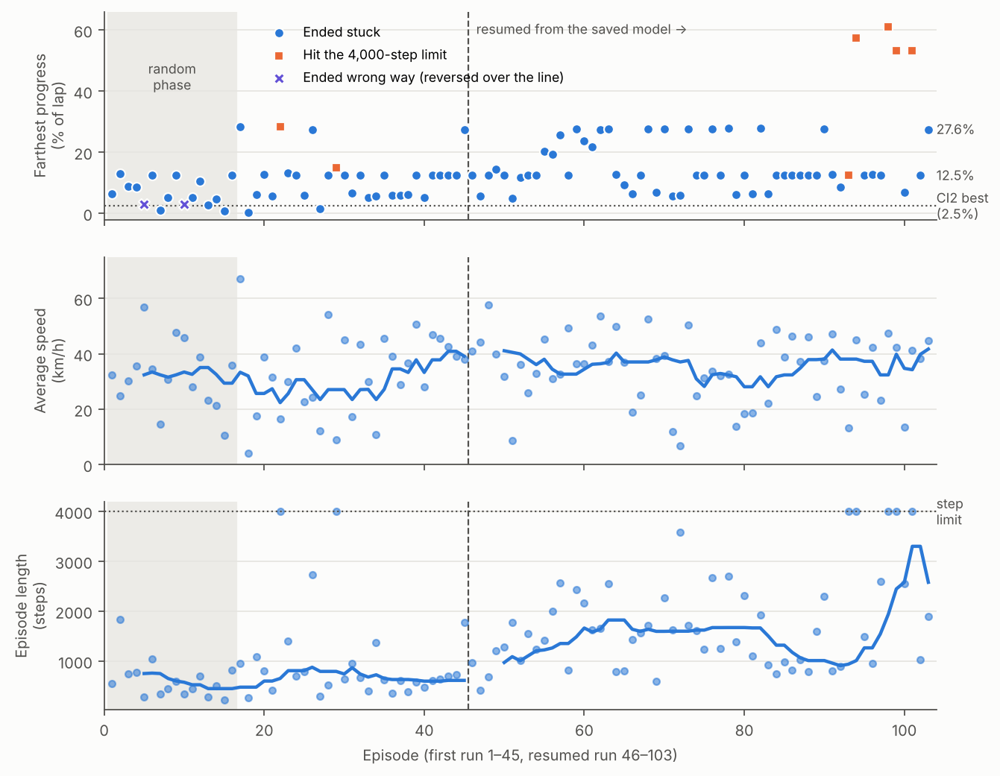
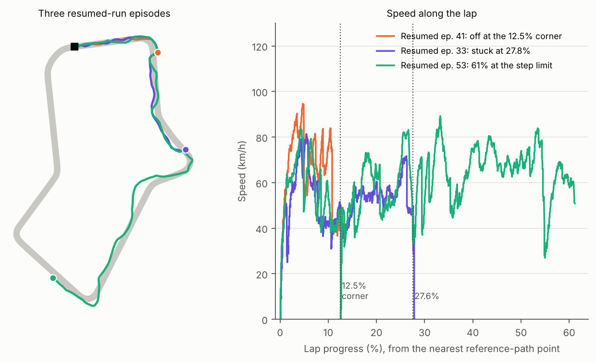

# DSAN-6600-Project

Semester Project for DSAN 6600: Deep Learning and Neural Networks

We use [ACRL](https://github.com/Jurredr/ACRL), a Soft Actor-Critic (SAC) implementation for Assetto Corsa, to train an agent that can drive a lap of a race track on its own. If it gets there, our next target is the lap time set by Assetto Corsa's built-in AI on the same car and track.

**Status (Check-In 3):** We trained SAC with the extension and the shared fixes for 140,541 steps over two runs (one seed, a first run and a resumed continuation). The car now drives at 30–40 km/h on average instead of creeping, and the farthest it got rose from 2.5% of a lap at Check-In 2 to 61%. No episode has completed a lap yet, and the episodes that got past halfway did so with the lap already marked invalid. Most episodes end stuck at the same three places on the track, and the longest episodes now hit the 4,000-step limit while still driving. The SAC baseline with shared fixes has not been trained yet, so we cannot yet say how much of this change comes from the extension rather than from the shared fixes (Section 4). (To be added: comparison and held-out evaluation)

## Check-In 3 at a Glance

| Rubric item | Where to look | Status |
| --- | --- | --- |
| Advanced extension | [3. Advanced Extension](#3-advanced-extension) | Implemented; first two training runs done ([3.4](#34-evidence-that-it-runs)) |
| Comparison with the CI2 baseline | [4. Comparison with the Baseline](#4-comparison-with-the-baseline) | Not run yet: needs the SAC baseline (shared fixes) and the held-out evaluation |
| Ablation / controlled comparison | [5. Ablation](#5-ablation) | (To be added) |
| Failure analysis | [6. Failure Analysis](#6-failure-analysis) | Patterns from the first two training runs; held-out evaluation still to come |
| Progress video (~5 min) | (To be added: link) | (To be added) |
| Demo notebook | (To be added: link) | (To be added) |
| Code | [1.3 Repository and How to Run](#13-repository-and-how-to-run) | (To be added) |

**Key result:** (To be added: completion rate, net progress, and farthest progress of the baseline with shared fixes vs. the extension under the same evaluation, number of seeds, and whether the difference is larger than the variation between seeds)

The full Check-In 2 write-up (training runs, log checks, and failure analysis of the original baseline) is in [check-in-2.md](check-in-2.md).

## 1. Project Overview

### 1.1 Goal

AI opponents largely decide how challenging and fun a racing simulator feels. Unlike chess or Go, racing needs continuous control of steering, throttle, and brake while reacting to how the car moves, and one small mistake can ruin a corner or invalidate a lap. We want to see how far an agent that learns only by driving can get.

| Stage | Goal | How we measure it |
| --- | --- | --- |
| **1. Complete a lap (main goal)** | From the standard start position, the agent drives forward to the finish line on its own, and the game never marks the lap invalid. | Lap completion rate in held-out evaluation; environment steps until the first completed lap |
| **2. Catch the built-in AI (stretch goal)** | Once the agent completes laps reliably, close the gap to Assetto Corsa's built-in AI in the same car on the same track. | Median time of full timed laps compared with the built-in AI's lap, re-recorded on our tires (the current reference, **1:25.454**, was set on faster tires) |

**What a completed lap means for Stage 1.** Every episode starts with the car at rest about 0.15% of a lap past the start/finish line. A Stage 1 lap is the drive from there, forward around the track, to the finish line: about 99.85% of the lap, from a standing start. It is not a full timed lap (line to line at racing speed), which only matters for Stage 2. The evaluation in [4.1](#41-evaluation-protocol) applies exactly this definition.

At Check-In 2, the SAC baseline never completed a lap: the original reward led the car toward standing still, and with a revised reward every episode still ended with the car stuck within the first 2.5% of the lap. For Check-In 3 we fixed the bugs found at Check-In 2 for every condition alike ([2.3](#23-shared-fixes-since-check-in-2)) and added one extension on top of SAC ([3](#3-advanced-extension)).

### 1.2 Scope

One car, one track, no opponents, fixed driving conditions.

| Setting | Value |
| --- | --- |
| Car and track | Ferrari 458 GT2 on Silverstone 1967 (the defaults in `main.py`) |
| Session settings | (To be added: tires, assists, weather, grip, fuel) |
| Hardware | (To be added) |
| Training budget | Check-In 2: about 720,000 environment steps over four runs. Check-In 3 so far: 39,418 steps (first run, ~1.1 hours) and 101,123 steps (resumed run, ~2.5 hours), both SAC + extension |

### 1.3 Repository and How to Run

| Folder or file | Contents |
| --- | --- |
| `README.md` | This write-up (Check-In 3) |
| `check-in-2.md` | Check-In 2 write-up, kept for reference |
| `figures/` | All plots in both write-ups |
| `logs/<run name>/` | Episode logs (`progress.txt`) and evaluation results of every run |
| (To be added) | Demo notebook with the comparison results |
| (To be added) | Code (layout below) |

```
(To be added: final code layout, including the extension's files)
ACRL.py                         # In-game app: sends telemetry from Assetto Corsa over a socket
standalone/
├── main.py                     # Entry point: settings, hyperparameters, start or resume training
├── evaluate.py                 # Held-out evaluation without learning
├── ac_controller.py            # Virtual Xbox controller (vgamepad)
├── ac_socket.py                # Socket connection to the in-game app
└── sac/
    ├── ac_environment.py       # Gymnasium environment: observations, reward, termination
    ├── sac.py                  # SAC agent, replay buffer, training loop
    ├── core.py                 # Actor and critic networks
    └── utils/                  # Reference-path geometry, logging
track_data/spline_points.csv    # Reference path (from upstream ACRL)
```

**Setup.** Install Assetto Corsa and follow the upstream [setup instructions](https://github.com/Jurredr/ACRL#readme), copy the in-game app into `assettocorsa/apps/python/ACRL`, enable it, and start a practice session with the car and track above.

**Commands** (from `standalone/`, with the game running):

| Task | Command |
| --- | --- |
| Train the SAC baseline with shared fixes | (To be added) |
| Train the extension | (To be added) |
| Train the ablation condition | (To be added) |
| Evaluate a saved model | `python evaluate.py --model experiments/<run name> --episodes 20` |
| Evaluate random actions | `python evaluate.py --random --episodes 20 --seed 0` |

## 2. Baseline

### 2.1 Conditions Compared

"The CI2 baseline" can mean two different things, so we keep them apart:

| Name in this write-up | What it is | Role |
| --- | --- | --- |
| **Original CI2 checkpoint** | The model saved at Check-In 2 (`experiments/reward_check_2_resume/model.pt`), trained with the Check-In 2 code | Reference only: shows how far we are from where we stood at Check-In 2. Its training conditions differ from the others. |
| **SAC baseline (shared fixes)** | SAC without the extension, retrained with every shared fix in [2.3](#23-shared-fixes-since-check-in-2) | **Main comparison.** Differs from the extension only by the extension. |
| **SAC + extension** | The same, with the extension added | The condition being tested |
| Random actions | Uniform random actions, no learning | Floor for every metric |

Differences between the original CI2 checkpoint and the SAC baseline (shared fixes) come from the shared fixes. Differences between the SAC baseline (shared fixes) and SAC + extension come from the extension. (To be added: whether the original CI2 checkpoint was evaluated, and the runs and seeds behind each condition)

### 2.2 Shared Setup

The task, network, and SAC settings below are the same for every trained condition unless Section 3 says otherwise. Check-In 2 has the full description ([check-in-2.md, Section 2](check-in-2.md#2-neural-baseline-sac)).

| Component | Setting |
| --- | --- |
| Observation (10 values) | Lap progress, speed, world x/y/z, lap-invalid flag, lap count, previous lap progress, heading error and distance relative to the reference path |
| Action (2 values in [−1, 1]) | Combined throttle/brake, steering |
| Reward | The Check-In 2 progress + speed reward (`reward_id=4`), unchanged; the penalty for ending stuck is now −100 (was −40), and the same penalty applies when the car reverses over the start line |
| Episode end | Finish line reached (99% progress), car stuck (100 steps below 2 km/h), car reversed over the start line (`wrong_way`), or 4,000 steps |
| Policy | MLP 10 → 256 → 256, squashed Gaussian |
| Critics | Two MLPs 12 → 256 → 256 → 1, Polyak-averaged targets (0.999) |
| SAC settings | Adam, learning rate 1e-3, γ = 0.99, α = 0.2 (fixed), batch 32, buffer 10⁶, seed 0. A new run takes 10,001 random actions before the policy acts; a resumed run takes 1. Gradient updates start after 1,000 steps and run after each episode, one per environment step. |
| Control interval | At least 50 ms between observations. The measured median was 80 ms in the first CI3 run and 60 ms in the resumed run, so the 50 ms target was not reached ([6.4](#64-implications)). |

### 2.3 Shared Fixes Since Check-In 2

These fixes change the environment or the training loop, so they apply to every trained condition. Any improvement they cause is credited to the fixes, not to the extension.

| Fix | Problem it addresses (Check-In 2) | Status |
| --- | --- | --- |
| Model loading | Saved models could not be loaded ([CI2 4.2](check-in-2.md#42-saved-models-could-not-be-loaded)) | Done at Check-In 2 |
| Lap check | Reversing over the start line counted as a finished lap ([CI2 4.6](check-in-2.md#46-reversing-over-the-start-line-counts-as-a-finished-lap)) | Done: ends as `wrong_way` with the stuck penalty |
| Update timing | The car drove blind during gradient updates ([CI2 4.7](check-in-2.md#47-the-car-drives-blind-during-gradient-updates)) | Done: updates run after each episode with the car braked |
| Reset | One episode started 100 m down the track ([CI2 3.3](check-in-2.md#33-log-artifacts)) | Done: F10 is pressed again if the car did not respawn |
| Logging | End reasons, reward components, and step timestamps were not logged | Partly done: end reason, net and farthest progress, step time, update count and time, losses, and Q-values are logged; reward components are not |
| Stuck penalty | Getting stuck cost too little compared with driving ([CI2 4.5](check-in-2.md#45-the-revised-reward-may-still-give-too-little-incentive-to-drive)) | Done: −40 → −100. The reward function itself is unchanged; exploration is part of the extension (Section 3). |
| Control interval | Step time was not fixed (17–92 ms at Check-In 2) | Done: at least 50 ms per step |
| Step-limit bootstrapping | Hitting the step limit was stored as a terminal state | Done: only real endings stop bootstrapping |
| Q-network freeze | A one-shot iterator meant the critics were never frozen during the policy update | Done (bug fix) |
| In-game app | Socket encoding error broke the F10 respawn; app window could end up off-screen | Done: `ACRL.py` fixes and auto-start |

## 3. Advanced Extension

### 3.1 What We Added and Why

| | |
| --- | --- |
| Extension | Data-centric changes to what SAC learns from: structured exploration in the random phase, and fixed normalization of the observations fed to the policy and critics |
| Rubric category | Data-centric improvement tied to model behavior |
| What it adds beyond Check-In 2 | At Check-In 2, the replay buffer was filled with uniform random actions that braked half the time, and the networks received raw inputs on very different scales. The extension changes the data the networks train on and the form in which they see it. The SAC algorithm and the network sizes stay the same. |
| Scope | In: the random-phase action distribution and input normalization. Out: the reward, the environment, the network architecture, and the bug fixes in [2.3](#23-shared-fixes-since-check-in-2), which apply to every condition. |

**Motivation.** Two Check-In 2 findings point at the training data rather than at SAC itself:

- **The random phase produced almost no driving.** Throttle and brake share one action axis, so uniform random actions braked half the time, and a new action was drawn every step, so no throttle press lasted long enough to build speed. In the random phase of the revised-reward run, median speed was 2.1 km/h ([CI2 4.5](check-in-2.md#45-the-revised-reward-may-still-give-too-little-incentive-to-drive)). The first 10,001 transitions in the replay buffer therefore contain almost no examples of the car moving at real speed, which leaves the critics little to learn from about driving.
- **The inputs differ in scale by three orders of magnitude.** Lap progress lies in [0, 1], speed reaches 180 km/h, and the world coordinates reach about ±1,000 m on this track. Fed in raw, the coordinates dominate the first layer of every network.

**Hypothesis.** Under the same budget and shared fixes, the extension raises the speed reached in the random phase and, after the policy takes over, increases net progress and farthest progress per episode and lowers the share of episodes that end stuck, compared with the SAC baseline (shared fixes).

**How the Check-In 3 code changes are split.** The changes made since Check-In 2 that belong to the extension are switched on and off together in `main.py`; everything else applies to every condition.

| Change | Where | Extension or shared fix |
| --- | --- | --- |
| Throttle-biased, held random actions | `sac.py`, `main.py` | Extension |
| Observation normalization | `core.py`, `sac.py`, `ac_environment.py` | Extension |
| Updates run between episodes, car braked | `sac.py` | Shared fix ([CI2 4.7](check-in-2.md#47-the-car-drives-blind-during-gradient-updates)) |
| Fixed 50 ms control interval | `ac_environment.py` | Shared fix |
| Reversing over the start line ends the episode as `wrong_way` | `ac_environment.py` | Shared fix ([CI2 4.6](check-in-2.md#46-reversing-over-the-start-line-counts-as-a-finished-lap)) |
| Reset check (re-press F10 if the car did not respawn) | `ac_environment.py` | Shared fix ([CI2 3.3](check-in-2.md#33-log-artifacts)) |
| Stuck penalty −40 → −100 | `main.py` | Shared fix ([CI2 4.5](check-in-2.md#45-the-revised-reward-may-still-give-too-little-incentive-to-drive)) |
| No `done` flag at the step limit (critic keeps bootstrapping) | `sac.py` | Shared fix |
| Q-networks actually frozen during the policy update | `sac.py` | Shared fix (bug) |
| New log columns: end reason, net and farthest progress, step time, update count and time, losses, Q-values | `sac.py` | Shared fix |
| In-game app: socket and F10 respawn fixes, auto-start, camera lock only outside the pit | `ACRL.py` | Shared fix |

### 3.2 Design

Both parts sit at the edges of SAC: one changes which transitions enter the replay buffer, the other changes what the networks see. The policy, the critics, and the SAC updates are unchanged.

```
random phase (first 10,001 actions):  biased, held random action ─┐
policy phase:                          policy action (every step) ─┤
                                                                   ▼
                                              Assetto Corsa (50 ms per step)
                                                                   │
                                     transition (s, a, r, s') ─► replay buffer
                                                                   │
                     s ─► (s − center) / scale ─► policy MLP and both critic MLPs
```

**Structured exploration.** During the random phase, each random action is drawn as follows and then held for 5–15 steps (0.25–0.75 s at 50 ms per step):

| Action axis | SAC baseline (shared fixes) | SAC + extension |
| --- | --- | --- |
| Throttle/brake | Uniform in [−1, 1]: brakes half the time | Uniform in [−0.2, 1]: throttle on about 83% of draws, braking only light |
| Steering | Uniform in [−1, 1] (up to ±270°) | Uniform in [−0.5, 0.5]: holding full lock for several steps mostly spins the car |
| New action drawn | Every step | Every 5–15 steps |

Once the policy takes over, it chooses a new action every step in both conditions. A run resumed from a saved model skips the random phase (`start_steps` is set to 0), so this part has no effect there.

**Observation normalization.** Each input is mapped to roughly [−1, 1] as `(s − center) / scale` before the first layer of the policy and of both critics. The constants are fixed by hand from the known range of each input, not estimated from data:

| Input | Center | Scale | Note |
| --- | --- | --- | --- |
| Lap progress, previous lap progress | 0.5 | 0.5 | |
| Speed (km/h) | 90 | 90 | Half of `max_speed` |
| World x, y, z (m) | 0 | 1,000 | Silverstone 1967 lies within about ±1,000 m (the observation bound is ±2,000) |
| Lap-invalid flag | 0.5 | 0.5 | |
| Lap count | 1.5 | 0.5 | |
| Heading error (rad) | π/2 | π/2 | |
| Distance from the reference path (m) | 10 | 10 | Normal values are 0–20 m; the 0–500 bound would squash them toward −1 |

The constants are stored inside the model as buffers, so `model.pt` carries them and `evaluate.py` or a resumed run applies the same normalization automatically. Models saved before this change have no such buffers and still run without normalization.

| Component | SAC baseline (shared fixes) | SAC + extension |
| --- | --- | --- |
| Observation | 10 raw values | The same 10 values, normalized inside each network |
| Policy network | MLP 10 → 256 → 256, squashed Gaussian | Same |
| Critic networks | Two MLPs 12 → 256 → 256 → 1 | Same, on normalized observations |
| Random phase | Uniform actions, new one every step | Biased actions, each held for 5–15 steps |
| Trainable parameters | ~208,000 | ~208,000 (the normalization constants are fixed buffers, not trained) |

### 3.3 Implementation

| Item | Details |
| --- | --- |
| Files changed | `standalone/sac/core.py`: optional `(center, scale)` buffers in the actor and both critics, applied in `forward`. `standalone/sac/sac.py`: `_sample_explore_action` (biased, held random actions) and the new options of `SacAgent`. `standalone/sac/ac_environment.py`: `obs_norm_center` and `obs_norm_scale`. `standalone/main.py`: the settings below. Changed lines are marked `[CI3 change]`, with the old code kept as comments. |
| How to turn it on | In `HYPERPARAMS` in `main.py`: `explore_throttle_range=(-0.2, 1.0)`, `explore_steer_range=(-0.5, 0.5)`, `explore_action_repeat=(5, 15)`, `normalize_obs=True` (the current settings) |
| How to turn it off (baseline) | `explore_throttle_range=(-1.0, 1.0)`, `explore_steer_range=(-1.0, 1.0)`, `explore_action_repeat=(1, 1)`, `normalize_obs=False`, which reproduce the old uniform sampling and raw inputs. The shared fixes stay on. |
| Extra hyperparameters | The two exploration ranges, the hold length (5–15 steps), and the normalization constants above. `policy_action_repeat` stays at 1. |
| Extra compute | No extra trainable parameters; normalization adds one subtraction and one division per input. (To be added: measured time per step and per update, from the new `StepTime` and `UpdateTime` log columns) |

### 3.4 Evidence That It Runs

We trained SAC + extension with the shared fixes from scratch (`ci3_track_start`, seed 0), then resumed it from its saved model in a second run (`ci3_track_start_resume`; its `config.json` records `load_path=experiments/ci3_track_start` and `start_steps=0`). Both are training episodes with a stochastic policy, not the held-out evaluation in Section 4.

| Run | Episodes | Environment steps | Wall-clock time | Median step time | Logs |
| --- | --- | --- | --- | --- | --- |
| First run (`ci3_track_start`) | 45 | 39,418 | ~1.1 h | 80 ms | [progress.txt](logs/ci3_track_start/progress.txt) |
| Resumed run (`ci3_track_start_resume`) | 58 | 101,123 | ~2.5 h | 60 ms | [progress.txt](logs/ci3_track_start_resume/progress.txt) |

| Episodes | Actions | Median length (steps) | Median speed (km/h) | Median farthest progress (% of lap) | Farthest (% of lap) | End reasons |
| --- | --- | --- | --- | --- | --- | --- |
| First run, 1–16 | Random | 530 | 31.6 | 5.8 | 13.1 | 14 stuck, 2 wrong way |
| First run, 17 | Random (60 steps), then policy | 956 | 67.0 | 28.4 | 28.4 | Stuck |
| First run, 18–45 | Policy | 653 | 34.0 | 12.4 | 28.5 | 26 stuck, 2 step limit |
| Resumed, 1–20 | Policy | 1,354 | 37.1 | 12.6 | 27.6 | 20 stuck |
| Resumed, 21–40 | Policy | 1,594 | 31.7 | 12.6 | 27.8 | 20 stuck |
| Resumed, 41–58 | Policy | 1,740 | 39.8 | 12.6 | 61.1 | 13 stuck, 5 step limit |
| Check-In 2, revised reward (189 episodes, for reference) | Random, then policy | 346–593 | 2.1–3.2 | — | 2.4 | All stuck |

Wrong-way episodes are left out of the progress columns: their net progress is negative.



*Farthest progress, average speed, and episode length for every episode of the first CI3 run (1–45) and the resumed run (46–103), with a 10-episode rolling median for speed and length. The shaded band marks the random phase. Marker shape shows how each episode ended.*

**What the two runs show**

- **The extension runs end to end.** The random phase used throttle-biased, held actions (`RandomFrac` = 1 through episode 16, and 60 steps of episode 17, 10,001 actions in total). The loaded model kept its observation normalization in the resumed run.
- **The random phase now drives.** Its median speed was 31.6 km/h and it got as far as 13.1% of the lap, compared with 2.1 km/h and 2.2% in the Check-In 2 random phase. The replay buffer therefore starts with real driving.
- **The car went much further than at Check-In 2,** but not around the lap. The first run's best was 28.5%, the resumed run's 61.1% (about 2.9 km). Those long drives were not clean: every step-limit episode received the one-time off-track penalty, so the game had marked the lap invalid ([6.1](#61-failure-patterns-of-the-extension)). Five resumed episodes and one first-run episode ended with a positive total reward; none did at Check-In 2.
- **Progress stalls at fixed places.** The median farthest progress sat at 12.4–12.6% for the whole of both policy phases, because most episodes end at the same corner ([6.1](#61-failure-patterns-of-the-extension)).
- **The step limit now binds.** None of the five step-limit endings in the resumed run was a stuck car, and four of them came past 53% of the lap.

These runs changed the extension and the shared fixes at the same time, and the car now spawns just before the start line and is driven across it before each episode starts. They show that the system works and how it fails; they do not show that the extension caused the improvement. That needs the SAC baseline (shared fixes) under the same budget (Section 4).

## 4. Comparison with the Baseline

**Status:** not run yet. The SAC baseline (shared fixes) still has to be trained with the same seed and budget as the extension runs in [3.4](#34-evidence-that-it-runs), and every condition still has to be run through `evaluate.py`.

### 4.1 Evaluation Protocol

Training episodes use a stochastic policy that is still learning, so all conditions are compared on separate held-out episodes instead.

| Item | Setting |
| --- | --- |
| Tool | `standalone/evaluate.py`: loads a saved model and drives with it; no gradient updates and no replay buffer, so nothing it sees reaches training |
| Conditions | The four in [2.1](#21-conditions-compared) |
| Actions | Trained policies: deterministic mean action. Random: uniform over [−1, 1] |
| Episodes | (To be added: per condition and seed) |
| Seeds | (To be added: training seeds per condition, evaluation seed) |
| Checkpoint | (To be added: final checkpoint, or a rule fixed before looking at test results) |
| Start | Standard reset and scripted launch, as in training |
| Environment | Shared setup in [2.2](#22-shared-setup) and fixes in [2.3](#23-shared-fixes-since-check-in-2). The script also applies the stuck rule after 99% progress, where the environment would otherwise report the lap as done. |

**Completed lap.** A Stage 1 lap as defined in [1.1](#11-goal): the game's lap count goes up because the car crossed the finish line going forward, the game never marked the lap invalid, and lap progress never jumped by more than half a lap in one step (a backward crossing of the start line ends the episode as a failure). Episodes where the environment reports 99% progress but the car never crosses the line do not count.

**Metrics.**

| Metric | Use |
| --- | --- |
| Lap completion rate | Main metric (Stage 1) |
| Net progress per episode, farthest progress | Progress before any lap is completed |
| Share of episodes ending stuck, and where they end | Failure analysis |
| Average speed | Secondary |
| Approximate lap time (completed laps only) | Reported, not compared: it is the game's timer at the last sample before the line, from a standing start |
| Training wall-clock time | Cost |

### 4.2 What Was Held Fixed

| Item | SAC baseline (shared fixes) | SAC + extension | Same? |
| --- | --- | --- | --- |
| Code version and shared fixes | (To be added) | (To be added) | (To be added) |
| Reward and termination | (To be added) | (To be added) | (To be added) |
| Training budget (environment steps) | (To be added) | (To be added) | (To be added) |
| SAC hyperparameters and update schedule | (To be added) | (To be added) | (To be added) |
| Training seeds | (To be added) | (To be added) | (To be added) |
| Evaluation | Section 4.1 | Section 4.1 | Yes |
| Hardware | (To be added) | (To be added) | (To be added) |

(To be added: anything that could not be matched, and its likely effect)

### 4.3 Results

| Metric | Random actions | Original CI2 checkpoint | SAC baseline (shared fixes) | SAC + extension |
| --- | --- | --- | --- | --- |
| Lap completion rate | (To be added) | (To be added) | (To be added) | (To be added) |
| Median net progress per episode (% of lap) | (To be added) | (To be added) | (To be added) | (To be added) |
| Farthest progress (% of lap) | (To be added) | (To be added) | (To be added) | (To be added) |
| Share of episodes ending stuck | (To be added) | (To be added) | (To be added) | (To be added) |
| Median average speed (km/h) | (To be added) | (To be added) | (To be added) | (To be added) |
| Training wall-clock time | – | – | (To be added) | (To be added) |

| Seed | SAC baseline (shared fixes): completion rate / median net progress | SAC + extension: completion rate / median net progress |
| --- | --- | --- |
| (To be added) | (To be added) | (To be added) |

(To be added: learning curves of both trained conditions, e.g. `figures/ci3_learning_curves.png`)

### 4.4 What Improved, What Got Worse, and Why

| | Original CI2 checkpoint → SAC baseline (shared fixes) | SAC baseline (shared fixes) → SAC + extension |
| --- | --- | --- |
| Credited to | Shared fixes | Extension |
| Improved | (To be added) | (To be added) |
| Worse or unchanged | (To be added) | (To be added) |

**Why.** (To be added: explanation, marked as a hypothesis where untested)

**How sure we are.** (To be added: number of seeds, and the difference compared with the spread between seeds)

## 5. Ablation

One controlled change, with everything else held at the Section 4.2 settings.

| | |
| --- | --- |
| Question | (To be added) |
| Change | (To be added: the one component removed, replaced, or varied) |
| Held fixed | Budget, seeds, shared fixes, evaluation (Section 4.1) |

| Metric | (To be added: condition A) | (To be added: condition B) |
| --- | --- | --- |
| Lap completion rate | (To be added) | (To be added) |
| Median net progress per episode (% of lap) | (To be added) | (To be added) |
| Farthest progress (% of lap) | (To be added) | (To be added) |
| Share of episodes ending stuck | (To be added) | (To be added) |

**Interpretation.** (To be added)

## 6. Failure Analysis

### 6.1 Failure Patterns of the Extension

| Pattern | Episodes (share) | Where on the track | Example (run, seed, episode) | Likely cause |
| --- | --- | --- | --- | --- |
| Leaves the track at the first right-hander and stops | First run 17 of 43, resumed 26 of 58 | About 12.5% of the lap (~600 m), where the opening straight turns right | First run, episodes 9, 16, 24, 41–44; resumed, episodes 39–44 | The car stops about 33 m off the reference line within 5 m of the same point, (x, z) ≈ (438, −785), in 32 episodes across both runs. Hypothesis: it reaches the corner too fast and does not brake. Episodes that stopped here were going faster at 10% of the lap (median 68 km/h, 37 episodes) than episodes that got past the corner (57 km/h, 26 episodes), but the ranges overlap widely, so this only weakly supports the hypothesis. The observation describes the car's position relative to the nearest point of the reference path only, so the policy gets no warning that a corner is coming. |
| Runs wide on the opening straight | First run 16 of 43, resumed 12 of 58 | About 5–9% of the lap | First run, episodes 1, 8, 11, 25; resumed, episodes 2, 26, 34 | Most of these stop about 30 m off the line: the car drifts off the straight before the first corner |
| Stops at the right-hand kink | First run 4 of 43, resumed 11 of 58 | About 27.5% of the lap (~1.3 km) | First run, episodes 17, 26, 45; resumed, episodes 33, 37, 45 | The second place where episodes repeatedly end, mostly 12–25 m off the reference line |
| Hits the step limit while still driving, on an invalid lap | First run 2 of 45, resumed 5 of 58 | 53–61% of the lap in four resumed episodes | Resumed episodes 49 and 53 | At the observed ~60 ms per step, 4,000 steps is about 4 minutes; at the 42–48 km/h these episodes averaged, a full lap would take about 6,000–6,800 steps. All seven step-limit episodes received the one-time −5 off-track penalty (their lowest step reward is −4.8 to −5.4, which no other reward term can produce at these speeds), so the game had marked each lap invalid. The four longest drives spent 57–72% of their steps more than 15 m from the reference line. |
| Reverses over the start line | First run 2 of 45, resumed 0 | Start line | First run, episodes 5 and 10 (random phase) | Ended as `wrong_way` with the −100 penalty, as intended |

Counts use each episode's farthest progress (`EpFarthest`) and end reason from `progress.txt`; wrong-way episodes are excluded from the location rows. End positions, distances from the reference line, and speeds come from `drive_data.json` of both runs. The invalid-lap check relies on the logged lowest step reward, because the lap-invalid flag itself is not logged. All counts are from training episodes.

### 6.2 Concrete Examples


*Left: where each episode of both CI3 runs ended (wrong-way episodes left out), on a top-down view of the track; the car drives clockwise from the start/finish line. Right: farthest progress per episode, in 2% bins. The peaks at about 5–9%, 12.5%, and 27.5% are the three places where episodes keep ending.*



| Episode | What happens |
| --- | --- |
| **Resumed, episode 41** (ends at the 12.5% corner) | Reaches about 95 km/h on the opening straight, still runs 70–85 km/h near 10%, then leaves the track at the first right-hander and stops about 33 m off the line. |
| **Resumed, episode 33** (ends at 27.8%) | Gets through the first corner at about 40 km/h, accelerates to about 70 km/h down the next section, then stops at the right-hand kink. |
| **Resumed, episode 53** (61% at the step limit) | The farthest drive so far. It also takes the first corner slowly, but from about 10% of the lap on it runs mostly 20–40 m from the reference line, wide of the track drawn on the map, and the lap is marked invalid. The step limit ends it while it is still moving at about 50 km/h. |

Many of our runs ended at the area at the end of the first turn due to a wall that juts out diagonally at that area. The car then bumps off of that wall just far enough for it to accelerate into the wall again, bump off, and repeart. This behavior also is found in other episodes that end in a crash with the wall/timeout. While this can be solved by fixing our issues with the grass, there are sections of the track that have little to no grass run off and this may be something to note for later. 

### 6.3 Check-In 2 Failures Now

| CI2 failure | Addressed by | Evidence | Remaining issue |
| --- | --- | --- | --- |
| Drift toward standing still ([CI2 4.1](check-in-2.md#41-the-policy-learned-to-stand-still)) | Not separable yet (shared fixes and extension changed together) | Median speed 32–37 km/h in both CI3 runs, with no downward trend, vs. 0.8 km/h at the end of the CI2 overnight run | None seen so far |
| Every episode ends stuck ([CI2 4.5](check-in-2.md#45-the-revised-reward-may-still-give-too-little-incentive-to-drive)) | Not separable yet | Still 94 of 103 episodes, but mostly after driving 5–28% of the lap rather than within the first 2.5% | Episodes end at the same corners ([6.1](#61-failure-patterns-of-the-extension)) |
| False lap from reversing over the start line ([CI2 4.6](check-in-2.md#46-reversing-over-the-start-line-counts-as-a-finished-lap)) | Shared fix (lap check) | Two random-phase episodes of the first run reversed over the line; both ended as `wrong_way` with the −100 penalty, and their net progress was logged as −1%, not 99% | None seen |
| Driving blind during gradient updates ([CI2 4.7](check-in-2.md#47-the-car-drives-blind-during-gradient-updates)) | Shared fix (update timing) | All updates now run between episodes (`NumUpdates` per episode); step time stays within 77–83 ms (first run) and 57–63 ms (resumed run) with no jumps | Updates take 12–30% of wall-clock time while the car waits |
| Faulty reset ([CI2 3.3](check-in-2.md#33-log-artifacts)) | Shared fix (reset) | All 103 episodes in both runs started at the start line; no failed respawn was seen | None seen |

### 6.4 Implications

- **The 4,000-step limit now stands between the car and a lap.** At Check-In 2 the car never got far enough for the limit to matter. Now the best episodes are cut off past halfway. The limit should be raised, or set in seconds, for every condition before the comparison runs.
- **The 50 ms control interval was not reached.** Steps took 80 ms and 60 ms in the two runs, probably because reading the game state takes longer than 50 ms on the machines used. The interval is a floor, not a fixed value, so the two runs saw different amounts of driving per step. The comparison runs should use the same machine, and the interval should be set at or above the step time actually achieved.
- **The furthest progress comes off the track.** The reward charges a one-time −5 when the lap becomes invalid and then halves positive rewards, which is small next to what an episode earns by driving on. A valid Stage 1 lap needs the car to stay on track, so the evaluation counts these laps as failures. Logging the lap-invalid flag per episode, and a larger or repeated off-track penalty, would make this visible and costly. (To be added: decision, applied to every condition)
- **The failures are now about corners, not about moving.** The next fix is likely to come from the observation (something about the track ahead) or from the reward around corners, not from exploration. (To be added: confirmation from the held-out evaluation)

### 6.5 Remaining Limitations

- One car, one track, and fixed conditions, so the results say nothing about other cars, tracks, or conditions.
- Training runs in real time on one laptop, which limits the budget and the number of seeds.
- Both CI3 runs use one seed (0), and the second run continues the first. Any difference between conditions has to be larger than the variation between seeds before we can trust it. (To be added: seeds used in the comparison)
- (To be added: limitations of the extension)

## 7. Next Steps

1. Raise the step limit (or set it in seconds) and fix the control interval to a value every machine reaches, for all conditions.
2. Train the SAC baseline (shared fixes) with the same seed, budget, and machine as the extension.
3. Run `evaluate.py` on the random policy, the original CI2 checkpoint, the baseline, and the extension (Section 4.1).
4. Run the ablation (Section 5).
5. Look at the 12.5% corner in detail: speed and steering on approach, and whether a look-ahead input would help.
6. Fix reward spread/increase penalty for suboptimal actions (grass, wall hit, reversing unless necessary)  

## Milestones

| Stage | Deliverable | Deadline |
| --- | --- | --- |
| Check-In 2 | Working SAC baseline, training results, failure analysis ([check-in-2.md](check-in-2.md)) | 10/28/2026 |
| Check-In 3 | Advanced extension, comparison with the baseline, ablation, failure analysis, progress video | (To be added) |
| Stage 1 | First completed lap, then a reliable completion rate | TBD |
| Stage 2 (stretch) | Full timed laps compared with the built-in AI's lap re-recorded on our tires | TBD |
| Final evaluation | Frozen test results, uncertainty, failure analysis, limitations | TBD |

## AI Disclosure

Claude (Anthropic) was used to draft and edit the README and its structure, write analysis and plotting scripts and `evaluate.py`, and suggest debugging ideas. (To be added: confirm or adjust this to match how the team used AI tools)
