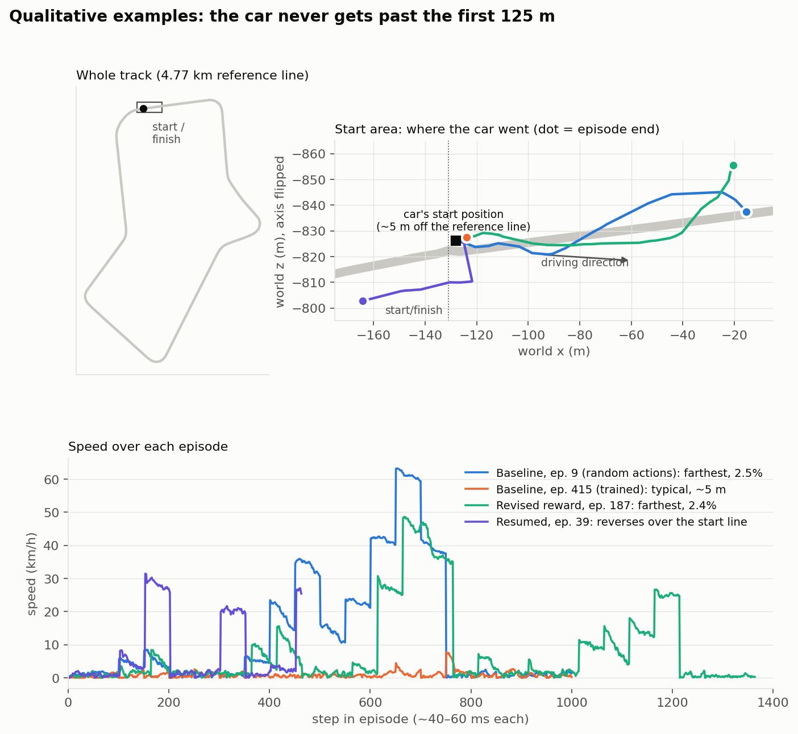

# DSAN-6600-Project

Semester Project for DSAN 6600: Deep Learning and Neural Networks

We use [ACRL](https://github.com/Jurredr/ACRL), a Soft Actor-Critic (SAC) implementation for Assetto Corsa, to train an agent that can drive a full, valid lap of a race track. If it gets there, our next target is the lap time set by Assetto Corsa's built-in AI on the same car and track.

**Status (Check-In 2):** Our SAC baseline trains end to end in Assetto Corsa. We have a five-episode pilot, one overnight baseline run (570 episodes), one run with a revised reward and early termination for stuck episodes (189 episodes), and a 61-episode continuation of that run resumed from its saved model. The baseline drifted toward standing still. In the revised run the car kept moving, and resuming from a saved model now works, but the car still does not get further around the lap. This check-in documents the baseline, what it produced, why it fails, and what we will change for Check-In 3 to get the car around a full lap.

## Check-In 2 at a Glance

| Rubric item | Where to look | Status |
| --- | --- | --- |
| Neural baseline | [2. Neural Baseline](#2-neural-baseline-sac) | SAC runs end to end; training setup documented |
| Results + evaluation | [3. Results and Evaluation](#3-results-and-evaluation) | Training-run results, learning curves, and qualitative examples done; held-out evaluation protocol written and a basic evaluation script implemented, not yet run in the game (results in CI3) |
| Failure analysis | [4. Failure Analysis](#4-failure-analysis) | Seven failures with evidence, causes, and fixes (model loading now fixed); next steps toward CI3 |
| Repo / write-up | [1.3 Repository and How to Run](#13-repository-and-how-to-run) | Layout and run steps; final layout |

**Key result:** the baseline is still far from Stage 1 (completing a lap). Over 570 training episodes, the policy learned to move *less* (median speed fell from 3.4 to 0.8 km/h) while its reward improved slightly, which suggests the reward favored a nearly stationary car. After we changed the reward, added stuck termination, and lengthened episodes, the car kept moving (median speed held at 2–3 km/h instead of collapsing), but every episode still ended with the car stuck, and the farthest it got (2.4% of a lap) is no better than before. Resuming that run from its saved model for another 61 episodes brought it back to about the same level, not beyond it. The driving logs also show that about 60% of the car's movement happens while the agent is paused for gradient updates and cannot see or steer the car ([4.7](#47-the-car-drives-blind-during-gradient-updates)).

## 1. Project Overview

### 1.1 Goal

AI opponents largely decide how challenging and fun a racing simulator feels. Unlike chess or Go, racing needs continuous control of steering, throttle, and brake while reacting to how the car moves, and one small mistake can ruin a corner or invalidate a lap. We want to see how far an agent that learns only by driving can get.

Our goals come in two stages:

| Stage | Goal | How we measure it |
| --- | --- | --- |
| **1. Complete a lap (main goal)** | The agent drives one full, valid lap of Silverstone 1967 without help. | Valid-lap completion rate in held-out evaluation; environment steps until the first valid lap |
| **2. Catch the built-in AI (stretch goal)** | Once the agent completes laps reliably, close the gap to Assetto Corsa's built-in AI in the same car on the same track. | Median valid lap time compared with the built-in AI's lap of **1:25.454**. That lap was set on faster tires than ours, so we will re-record the AI's time with our tires before comparing. |

Everything we change before Stage 2 serves Stage 1. In practice that means adjusting the reward, analyzing why episodes fail, and fixing whatever stops the car from getting around the track. A faster lap only counts once the car can finish laps reliably, so lap times are always reported together with the completion rate.

With limited time and compute, we aim to change one thing at a time and compare it with a reproducible baseline under matched conditions. Our first revision did not follow this: it changed the reward, added stuck termination, and raised the step limit together, so its results can't be credited to any one of these changes (Section 3.1). Matching the built-in AI's lap time would mean the agent is competitive with the game's own opponents. It would not, by itself, mean the agent drives at a human expert's level.

How we plan to get to Stage 1:

| Approach | Hypothesis | Controlled comparison |
| --- | --- | --- |
| **A. Adjust the reward** | The baseline reward makes standing still the safest choice (see [4.1](#41-the-policy-learned-to-stand-still)). A reward that pays for forward progress should get the car moving and further around the lap. | Compare the baseline reward with the revised reward, keeping everything else the same. |
| **B. Test the observations** | Absolute coordinates may help on a single track, but we don't know how much they actually contribute. | Mask the absolute coordinates while keeping the network architecture and other inputs unchanged. (Lower priority until the car completes laps.) |
| **C. Analyze failures** | Repeated failures, such as getting stuck or running off at the same corner, waste training steps and keep the car from finishing. | Find where and why episodes fail, then test one targeted fix at a time. |

We will start with A, guided by C: the CI2 baseline's main failure comes from the reward.

| Decision | Current plan |
| --- | --- |
| Main goal | Complete one full, valid lap (Stage 1) |
| First intervention | Revised reward (A) |
| Stage 2 trigger | (To be added: the completion rate at which we move on to lap time, e.g. a share of held-out episodes) |

### 1.2 Scope

One car, one track, no opponents, fixed driving conditions.

| Setting | Value |
| --- | --- |
| Car and track | Ferrari 458 GT2 on Silverstone 1967 (the defaults in `main.py`) |
| Session settings | (To be added: tires, assists, weather, grip, fuel) |
| Hardware | Team member's Windows laptop |
| Training budget so far | 5,000 steps (pilot), 570,000 steps (overnight baseline, ~6.9 hours), 119,138 steps (revised reward, ~1.8 hours), and 29,900 steps (revised reward resumed, ~0.5 hours) |

### 1.3 Repository and How to Run

```
ACRL_modified_code/
├── ACRL.py                  # In-game app: sends telemetry from Assetto Corsa over a socket
└── standalone/
    ├── main.py              # Entry point: car/track settings, hyperparameters, start or resume training
    ├── ac_controller.py     # Sends actions to the game through a virtual Xbox controller (vgamepad)
    ├── ac_socket.py         # Socket connection to the in-game app
    ├── test_gamepad.py      # Checks that controller inputs reach the game (added by us)
    ├── evaluate.py          # Held-out evaluation without learning (added by us; see 3.2)
    └── sac/
        ├── ac_environment.py   # Gymnasium environment: observations, reward, termination
        ├── sac.py              # SAC agent, replay buffer, training loop
        ├── core.py             # Actor and critic networks
        └── utils/
            ├── track_spline.py # Heading error and distance to the reference path
            └── logx.py         # Logging: progress.txt, config.json, model.pt, drive_data.json
track_data/spline_points.csv    # Reference path (from upstream ACRL)
experiments/<run name>/         # Created for each training run
```

This repository currently holds the write-up and its supporting files: `README.md`, `figures/` (all plots in this README), and `logs/<run name>/progress.txt` (the episode logs analyzed in Section 3). The code itself is not in this repository yet. To run it, you need our modified ACRL code (the layout above) plus `track_data/spline_points.csv` from [upstream ACRL](https://github.com/Jurredr/ACRL/tree/master/track_data), placed next to `standalone/`, because `main.py` reads `../track_data/spline_points.csv`.

**Running a training run**

1. Install Assetto Corsa and follow the upstream [setup instructions](https://github.com/Jurredr/ACRL#readme) (Visual C++ redistributable, MS-MPI, Python 3.3.5 for the in-game app).
2. Copy the in-game app into `assettocorsa/apps/python/ACRL` and enable it in the game settings.
3. Start a practice session with the chosen car and track.
4. Optional: run `python test_gamepad.py` from `standalone/` and switch to the game window to confirm throttle, steering, and brake reach the car.
5. Run `python main.py` from `standalone/`. It asks whether to load a previous model and for an experiment name, then trains. To resume, answer `y`, give the run folder (for example `experiments/reward_check_2`), and enter a **new** experiment name; reusing the old name overwrites that run's `progress.txt` and `model.pt`.
6. Results go to `experiments/<run name>/`: `progress.txt` (one row per episode), `config.json`, `model.pt`, and `drive_data.json`.

Resuming from a saved model works as of our latest code; see [4.2](#42-saved-models-could-not-be-loaded).

## 2. Neural Baseline (SAC)

### 2.1 Task as a Reinforcement Learning Problem

There is no fixed dataset. The agent collects its own training data by driving, and SAC learns from a replay buffer of that experience.

| Component | Definition |
| --- | --- |
| Observation (10 values) | Lap progress, speed (km/h), world x/y/z position, lap-invalid flag, lap count, previous lap progress, heading error relative to the reference path, distance from the reference path |
| Action (2 values, each in [-1, 1]) | Combined throttle/brake (positive = throttle, negative = brake) and steering |
| Reward (baseline) | `cos(θ) − \|sin(θ)\| − \|distance from reference path\| + speed / max_speed`, where θ is the heading error (ACRL's `_get_reward_5`) |
| Reward (revised run) | Our rewritten progress + speed reward (`reward_id=4`): scaled progress along the lap, a small speed term, a graded low-speed penalty, and a one-time off-track penalty, plus a penalty when an episode ends because the car is stuck (see [3.1](#31-training-runs)) |
| Episode end | Baseline: lap complete (progress ≥ 0.99 or lap count > 1), or 1,000 steps. Revised run: also ends when the car stays nearly stopped for 100 steps; limit raised to 4,000 steps |
| Step time | About 42 ms in our runs (not fixed; see [3.3](#33-log-artifacts)) |

### 2.2 Model

| Component | Configuration |
| --- | --- |
| Policy (actor) | MLP, 10 → 256 → 256 (ReLU), outputting the mean and log standard deviation of a Gaussian; actions squashed with tanh |
| Critics | Two Q-networks, each an MLP of 12 (state + action) → 256 → 256 (ReLU) → 1 |
| Target networks | Copies of both critics, updated by Polyak averaging |
| Parameters | About 208,000 in total (policy ~70,000; each critic ~69,000), computed from the layer sizes |

Source: [core.py](https://github.com/Jurredr/ACRL/blob/master/standalone/sac/core.py). We kept the network small on purpose: compute is limited, and the interventions we plan change the reward or the inputs, not the architecture.

### 2.3 Training Setup

**Loss functions** ([sac.py](https://github.com/Jurredr/ACRL/blob/master/standalone/sac/sac.py))

- **Critic loss:** mean squared error between each Q-network's estimate and the soft Bellman target  
  `y = r + γ (1 − done) [ min(Q1_target, Q2_target)(s', a') − α log π(a' | s') ]`, with `a'` sampled from the current policy. The two critic losses are summed.
- **Policy loss:** `mean( α log π(a | s) − min(Q1, Q2)(s, a) )`, which pushes the policy toward actions with high Q-value while keeping its entropy up.

**Optimizer and hyperparameters** (as set in `main.py`)

| Hyperparameter | Value |
| --- | --- |
| Optimizer | Adam, separate optimizers for the policy and the critics |
| Learning rate | 1e-3 (both) |
| Discount γ | 0.99 |
| Entropy coefficient α | 0.2 (fixed, not auto-tuned) |
| Polyak (target update) | 0.999 |
| Batch size | 32 |
| Replay buffer size | 1,000,000 |
| Random-action steps (`start_steps`) | 10,000 for a new run; 0 when resuming from a saved model. The policy acts only when `total_steps > start_steps`, so a new run takes 10,001 random actions and a resumed run takes 1 |
| Updates start after | 1,000 steps |
| Update schedule | Every 50 steps, 50 gradient updates (1 update per environment step on average) |
| Max episode length | 1,000 steps (baseline runs); 4,000 steps (revised run) |
| Seed | 0 (the default; one seed so far) |
| `max_speed` / steering range | 180 km/h / ±270° |

**"Splits" in this setting.** In reinforcement learning, the training data is generated by the agent itself, so there is no train/validation/test split of a dataset. We separate data by *how* it is collected:

| Role | What it is | Status |
| --- | --- | --- |
| Training | Episodes driven with the stochastic policy while learning, stored in the replay buffer | Done (Section 3.1) |
| Validation | Separate episodes with the deterministic policy and learning turned off, used to choose checkpoints and settings | **(To be added for CI3: run and report)** |
| Test | Held-out evaluation episodes of the final selected policy, never used for tuning and never added to the replay buffer | **(To be added for CI3: run and report)** |

### 2.4 Changes from Upstream ACRL

We based our code on upstream commit `ff1b5dd` and fixed problems as we found them, so the runs in Section 3 use three successive versions of the code:

| Runs | Code used |
| --- | --- |
| Pilot, overnight | The coordinate, velocity, zero-speed, and in-game app fixes below; baseline reward (`_get_reward_5`); 1,000-step limit |
| Revised reward (189 episodes) | The same, plus the rewritten reward mechanism (`reward_id=4`), stuck termination, and the 4,000-step limit |
| Revised reward, resumed (61 episodes) | The same as the revised run, plus the model-loading fix (last row below) |

From now on, every condition we compare will use the same, latest version.

| Problem in the original | Our fix | Why it matters |
| --- | --- | --- |
| Heading error and distance from the reference path used the car's world x and **y**. In Assetto Corsa, y is the vertical axis; the track lies in the x–z plane (the public position sample (-131.0, -0.4, -822.3) shows y near zero). | Use x and z. | Both values are observations and reward terms. With y, the agent was told how far it was from the line using its height. |
| The velocity for heading error used `velocity[0]` and `velocity[1]` (horizontal x and vertical y). | Use `velocity[0]` and `velocity[2]`. | Heading error now compares the car's direction of travel on the track with the reference path. |
| Heading error divided by the velocity's length without checking for zero, giving NaN for a stopped car. | Return heading error 0 when the car is nearly stopped. | Every episode starts from a standstill, so NaN could reach the replay buffer. **This fix contributed to the main failure in [4.1](#41-the-policy-learned-to-stand-still).** |
| The in-game app added its library paths after the imports that need them. | Add paths first; write import errors to `acrl_error.txt`. | The app loads reliably, and failures are easy to find. |
| Loading a saved model crashed (see [4.2](#42-saved-models-could-not-be-loaded)). | In `sac.py`: load `<run folder>/model.pt` with `weights_only=False` on the CPU, set `start_steps` to 0 when resuming, and always save `config.json`. | Training can continue from a saved model, and held-out evaluation of a saved model becomes possible. |

## 3. Results and Evaluation

### 3.1 Training Runs

| Run | Episodes | Environment steps | Wall-clock time | Purpose |
| --- | --- | --- | --- | --- |
| Pilot | 5 | 5,000 | ~2.7 min | Check that the training loop runs end to end |
| Overnight | 570 | 570,000 | ~6.9 h | First real training run (baseline reward) |
| Revised reward | 189 | 119,138 | ~1.8 h | First run after we rewrote the reward mechanism: test the revised reward, stuck termination, and 4,000-step limit |
| Revised reward, resumed | 61 | 29,900 | ~0.5 h | First run after we also fixed model loading: continue the revised-reward run from its saved model |

All four logs are clean at the episode-summary level: every value is finite, and `TotalSteps` always equals the sum of episode lengths. In the first two runs, every episode is exactly 1,000 steps. This says nothing about individual telemetry samples. Logs: [pilot](logs/demo_1/progress.txt), [overnight](logs/Checkin_3/progress.txt), [revised reward](logs/reward_check_2/progress.txt), [revised reward, resumed](logs/reward_check_2_resume/progress.txt).

**Pilot (first five episodes).** With `start_steps=10000`, every action in these 5,000 steps was random, so they serve as a preliminary random-action baseline. Net progress was 0.08–0.28% of a lap per episode, and every recorded step reward was negative.

| Episode | Episode reward | Final progress | Net progress | Avg. speed (km/h) |
| --- | --- | --- | --- | --- |
| 1 | -4,130 | 0.23% | 0.08% | 1.11 |
| 2 | -3,482 | 0.43% | 0.28% | 1.77 |
| 3 | -2,030 | 0.35% | 0.18% | 1.38 |
| 4 | -2,617 | 0.40% | 0.24% | 1.77 |
| 5 | -4,304 | 0.35% | 0.20% | 1.52 |

**Overnight run (570 episodes).** Medians by block of episodes:

| Episodes | Actions | Episode reward | Avg. speed (km/h) | Net progress (% of lap) | Episodes with any positive step reward |
| --- | --- | --- | --- | --- | --- |
| 1–10 | Random* | -5,248 | 3.44 | 0.55 | 0 / 10 |
| 11–50 | Policy | -5,365 | 3.16 | 0.45 | 5 / 40 |
| 51–100 | Policy | -5,029 | 1.55 | 0.19 | 0 / 50 |
| 101–200 | Policy | -4,768 | 1.07 | 0.14 | 6 / 100 |
| 201–300 | Policy | -4,745 | 0.80 | 0.08 | 2 / 100 |
| 301–400 | Policy | -4,858 | 0.85 | 0.09 | 0 / 100 |
| 401–500 | Policy | -4,717 | 0.82 | 0.09 | 1 / 100 |
| 501–570 | Policy | -4,932 | 0.81 | 0.10 | 2 / 70 |

\*The 10,001st random action falls on the first step of episode 11.

"Net progress" is the average per-step change in lap progress times the number of steps; forward and backward movement cancel out. "Final progress" (ACRL's `EpDist`) is the lap progress when the episode ended, which includes the ~0.15% the car starts into the lap. Medians are used because episode rewards vary widely.

**What the training results show**

- **The policy learned to move less.** Median speed fell from 3.4 km/h in the random phase to about 0.8 km/h by episode 200 and stayed there. Net progress fell from 0.55% to about 0.09% of a lap. The farthest any episode got was 2.5% of a lap, in episode 9, while actions were still random.
- **Reward improved while driving got worse.** Median episode reward rose by about 10% over the same period that progress fell about sixfold. Across all 570 episodes, reward was slightly negatively correlated with net progress (r ≈ −0.28), while speed and net progress moved together (r ≈ 0.96).
- **No episode completed a lap.** The completion rate for our main goal is 0%, and lap time is N/A. The farthest the car got was 2.5% of a lap.


*Episode reward, average speed, and net progress for each of the 570 episodes, with a 20-episode rolling median. The shaded band marks the random-action phase (episodes 1–10). Speed and progress drop once the policy starts choosing actions, while reward stays flat or improves slightly.*

**Revised-reward run (189 episodes).** This was our first run after rewriting the reward mechanism (Section 2.4). It used our rewritten progress + speed reward, ended episodes early when the car stayed nearly stopped for 100 steps, and raised the limit to 4,000 steps. The first 10,001 actions were random: all of episodes 1–22 and the first 301 steps of episode 23, after which the policy took over. The run's `config.json` confirms the settings: `reward_id=4`, a −40 stuck penalty, and termination after 100 consecutive steps below 2 km/h. This matches the log, where every episode's lowest step reward is about −40.4 (the stuck penalty plus the −0.4 low-speed penalty).

| Episodes | Actions | Median length (steps) | Stuck at 100 steps | Median speed (km/h) | Median net progress (% of lap) | Farthest (% of lap) | Episodes with any positive step reward |
| --- | --- | --- | --- | --- | --- | --- | --- |
| 1–23 | Random (ep. 23 mixed) | 346 | 3 | 2.1 | 0.15 | 2.2 | 14 / 23 |
| 24–50 | Policy | 453 | 1 | 2.9 | 0.28 | 1.3 | 21 / 27 |
| 51–100 | Policy | 593 | 7 | 2.1 | 0.24 | 1.5 | 34 / 50 |
| 101–150 | Policy | 537 | 8 | 2.1 | 0.23 | 2.4 | 36 / 50 |
| 151–189 | Policy | 577 | 3 | 3.2 | 0.48 | 2.4 | 34 / 39 |

Compared with the overnight baseline at the same budget (its first ~119,000 steps):

| | Overnight baseline | Revised reward |
| --- | --- | --- |
| Median speed during the policy phase | 1.9 km/h | 2.3 km/h |
| Median net progress | 0.27% | 0.26% |
| Farthest progress | 2.5% | 2.4% |
| Episodes with any positive step reward | 5 / 119 | 139 / 189 |
| End of this budget | Speed had fallen to 1.0 km/h | Speed rose to 3.2 km/h |

**What the revised run shows**

- **The car did not collapse into standing still.** Where the baseline's speed had already halved at this budget, the revised run held steady and rose in the last block (3.2 km/h, 0.48% of a lap). This run changed the reward, stuck termination, and the step limit at once, so we can't say which change made the difference. The upward trend after the random phase is weak (Spearman ρ ≈ 0.14, p ≈ 0.08); with one seed and consecutive training episodes that are not independent, we treat this as exploratory.
- **The reward now pays for moving.** 74% of episodes contain at least one positive step reward, compared with under 3% in the baseline.
- **Stuck episodes stop early.** 22 episodes ended after exactly 100 steps because the car never got moving, so far less training time went to dead episodes.
- **Every episode still ended with the car stuck.** None completed a lap or reached the 4,000-step limit. The farthest progress, 2.4% of a lap, is no better than the baseline. The completion rate is still 0%.


*Episode length, average speed, and net progress for each of the 189 episodes, with a 20-episode rolling median. The shaded band marks the random-action phase (episodes 1–23). Unlike the baseline, speed and progress do not fall once the policy takes over, but they do not climb much either.*

**Revised reward, resumed (61 episodes).** This was our first run after also fixing model loading ([4.2](#42-saved-models-could-not-be-loaded)). We continued the revised-reward run from its saved model (`experiments/reward_check_2` → `experiments/reward_check_2_resume`) with the same reward and settings. Its `config.json` records `load_path=experiments/reward_check_2` and `start_steps=0`, so the loaded policy drove from the second step on (the first action was random, as explained in Section 2.3), and the original run's files were left untouched. As expected, the replay buffer, optimizers, and step counter started over.

| Episodes | Median length (steps) | Stuck at 100 steps | Median speed (km/h) | Median net progress (% of lap) | Farthest (% of lap) |
| --- | --- | --- | --- | --- | --- |
| 1–20 | 275 | 3 | 2.3 | 0.13 | 1.3 |
| 21–40 | 352 | 2 | 3.2 | 0.33 | 1.4 |
| 41–61 | 623 | 1 | 2.9 | 0.44 | 1.7 |
| Original run, last 39 episodes (for reference) | 577 | 3 | 3.2 | 0.48 | 2.4 |

Episode 39 is left out of these numbers because it was a false lap completion (see [4.6](#46-reversing-over-the-start-line-counts-as-a-finished-lap)).

**What the resumed run shows**

- **Loading works.** The run started from the saved weights instead of from scratch and without 10,000 random steps.
- **It dipped at first, then returned to roughly where the original run ended.** In the first 20 episodes, speed and progress were lower than at the end of the original run. That fits the fresh replay buffer and optimizers: the policy is retrained on a small, new buffer. By episodes 41–61 it was back to about 3 km/h and 0.4% of a lap per episode. Over the whole resumed run, a Mann–Whitney test finds no clear difference in speed or progress from the original run's policy phase (p ≈ 0.23 and 0.70). That does not show the two are the same: there is one seed, and consecutive training episodes are not independent, so this comparison is exploratory.
- **The underlying problem is unchanged.** Apart from the false lap completion, every episode ended with the car stuck, the average reward per step was negative in every episode (best −0.28), and episode reward still tracked episode length almost exactly (r = −0.99). The farthest progress was 1.7% of a lap.


*The revised-reward run (episodes 1–189) followed by the resumed run, with a 20-episode rolling median for each segment. The dashed line marks the resume. After a short dip, the resumed run returns to roughly the level where the original run ended.*

### 3.2 Held-Out Evaluation

The numbers above come from training episodes, where the policy is stochastic and still learning. Following our evaluation plan, the baseline still needs a held-out evaluation.

| Metric | Random-action baseline | Trained SAC baseline |
| --- | --- | --- |
| Valid-lap completion rate | (To be added) | (To be added) |
| Median valid lap time | (To be added; expected N/A) | (To be added; expected N/A) |
| Median net progress per episode (% of lap) | (To be added) | (To be added) |
| Median average speed (km/h) | (To be added) | (To be added) |
| Share of episodes ending with the car stationary | (To be added) | (To be added) |

**Protocol (planned; results in CI3).**

| Item | Plan |
| --- | --- |
| Tool | `standalone/evaluate.py`, a separate script that loads a saved model and drives with it. It never runs gradient updates and keeps no replay buffer, so nothing it sees can leak into training. We have checked it only against a simulated environment, not yet in the game. |
| Policies | The latest saved model (`experiments/reward_check_2_resume/model.pt`) and uniformly random actions as the random-action baseline. Later, the final model of each training seed. |
| Actions | Deterministic: the policy's mean action (`deterministic=True`). Random baseline: uniform over [−1, 1] for both axes, seed 0. |
| Episodes | 20 per policy |
| Initial conditions | The standard reset (respawn at the start line, then the scripted launch), the same as in training |
| Environment | Same as the revised-reward runs: `reward_id=4`, stuck termination (100 steps below 2 km/h), 4,000-step limit |
| Output | One CSV row per episode: steps, reward, end reason, lap completed, lap valid, lap time, net and farthest progress, average and maximum speed, wall time |

**What counts as a valid lap.** The training environment ends an episode at 99% progress, which is not the same as crossing the finish line. In evaluation, the script ignores that and keeps driving until the game's lap count goes up. A lap counts as valid only if the car crosses the finish line this way, the game never marks the lap invalid, and progress never jumps by more than half a lap in one step (backward crossings of the start line end the episode as `wrapped_backward`; see [4.6](#46-reversing-over-the-start-line-counts-as-a-finished-lap)). The lap time is the game's own current-lap timer just before the crossing, which the in-game app already sends but the training environment does not use.

Usage, from `standalone/` with the game running as for training:

```
python evaluate.py --model experiments/reward_check_2_resume --episodes 20
python evaluate.py --random --episodes 20 --seed 0
```

One caveat: during training the agent loses sight of the car for about a second every 50 steps ([4.7](#47-the-car-drives-blind-during-gradient-updates)), but evaluation has no such pauses. Evaluation therefore measures the policy in conditions it was not trained in.

### 3.3 Log Artifacts

- **`EpDist` is not distance driven.** It is the lap progress at the end of the episode, and each episode starts about 0.15–0.16% into the lap (derived from the log). We use net progress instead.
- **Step time is not fixed.** Wall-clock time per logged step was 21–92 ms in the first two runs (median ~42 ms in the overnight run) and rose to a median of 56 ms in the revised run and 61 ms in the resumed run, so the same number of steps now covers less driving per training hour. It also includes gradient updates and saving, so it is not the control interval. Measuring the control interval would need per-step timestamps.
- **One episode did not reset properly.** Working backward from the log, episode 141 of the revised run started about 2.2% into the lap instead of the usual ~0.1%. Its driving data confirms this: the car began about 100 m down the track (x ≈ −27 m) rather than at the start (x ≈ −128 m), so its 2.4% final progress is not a real gain. The reset presses F10 to respawn the car; this press may not have registered. We need to check the reset.
- **One episode ended with a false lap completion.** Episode 39 of the resumed run shows progress jumping from about 0.2% to 99% in a single step, and the episode then ended as a completed lap. See [4.6](#46-reversing-over-the-start-line-counts-as-a-finished-lap).
- **Large position jumps every 50 steps.** In the driving data, the car's position jumps by up to several meters exactly when a gradient update happens. See [4.7](#47-the-car-drives-blind-during-gradient-updates).
- **End reasons and reward components are not logged.** The environment now returns an end reason (`lap_complete` or `stuck`) with each step, but `sac.py` does not write it to the log yet. We can't tell from the log why an episode ended or which reward term dominated. We are adding both.

### 3.4 Qualitative Examples

ACRL saves the car's speed and position for every step (`drive_data.json`). The figure below plots four episodes chosen to show typical and extreme behavior.



| Episode | What it shows |
| --- | --- |
| **Baseline, episode 415** (trained, typical) | The trained baseline barely moves. Over 1,000 steps the car covers about 5 m, mostly creeping forward under 2 km/h with occasional short bursts. This is the "start and brake" behavior. |
| **Baseline, episode 9** (random actions) and **revised reward, episode 187** | The farthest the car ever got: about 120 m, or 2.5% of the 4.77 km lap. In both, the car drifts to the left of the reference line and ends 15–30 m off it, near the first gentle bend. Speed peaks at 63 and 49 km/h, then the car stops. |
| **Resumed run, episode 39** | The car rolls backward and to the right, over the start/finish line, and ends about 36 m behind it. This is the false lap completion from [4.6](#46-reversing-over-the-start-line-counts-as-a-finished-lap). |

Two things stand out. First, every episode starts 4–5 m off the reference line, so the car pays a distance penalty from the very first step. Second, the speed traces rise and fall in steps exactly 50 steps apart. That pattern led us to the timing problem in [4.7](#47-the-car-drives-blind-during-gradient-updates).

## 4. Failure Analysis

### 4.1 The Policy Learned to Stand Still

**What happened.** After the overnight run, the car mostly accelerated briefly and then braked, staying near its starting position (Section 3.1).

**Why (hypothesis).** Under the baseline reward, standing still looks like the safest choice:

| Reward term | Stopped car | Moving car |
| --- | --- | --- |
| Heading `cos θ − \|sin θ\|` | **Always +1**, because our zero-speed fix returns heading error 0 | +1 down to −1.41 |
| Distance from the reference path | Constant | Grows if the car drifts |
| Speed `speed / 180` | 0 | Small at low speed (0.06 at 10 km/h) |

The driving data shows why the distance term is constant: the car always starts 4–5 m from the reference line, so a car that never moves loses about 4–5 per step from that term alone, close to the observed median step reward of about −4.7. Driving risks large penalties from bad headings and drifting (the worst step in the run was −22), while the upside at low speed is tiny. Nothing in the reward pays for forward progress, and the episode never ends early for being stuck. The car's drift toward standing still is consistent with a reward that favors it, but we have not shown that standing still is the reward's optimum; a direct check is to compare the per-step reward of a car held still with that of a car driven steadily at light throttle for about 100 steps (step 5 in [4.8](#48-next-steps-toward-check-in-3)). We had flagged this side effect when making the zero-speed fix.

**Fix.** Rewrite the reward so standing still is never the best option: give heading credit only while moving, add a scaled progress term, add a graded low-speed penalty, cap the distance penalty, and end episodes where the car stays stuck (with a penalty large enough that getting stuck on purpose doesn't pay). We checked the revised reward on hand-built situations: it ranks stopped < creeping < 30 km/h < 150 km/h, and reversing scores no better than stopping. In the revised run (Section 3.1) the car did not collapse into standing still, but it did not drive further either. That run also added stuck termination and a longer step limit, so the change in behavior can't be credited to the reward alone; see [4.5](#45-the-revised-reward-still-makes-getting-stuck-pay).

### 4.2 Saved Models Could Not Be Loaded

**Status: fixed and verified.** The resumed run in Section 3.1 loaded `experiments/reward_check_2/model.pt`, drove with the loaded policy from its second step (its first action was random; see Section 2.3), and wrote to a new folder.

**What happened.** Until this fix, we could not resume training from a saved model, including the overnight run's.

**Why.** Upstream ACRL never finished its load path:

1. It calls `logger.restore_state(load_path)`, which is not implemented in `EpisodeLogger`. Our first attempt added a `restore_state` method, which stops this crash, but the method does nothing useful: it receives a folder path rather than saved state, and the logger never saves episode statistics, so there is nothing to restore.
2. `main.py` requires a folder, but `sac.py` passes that folder straight to `torch.load`, which needs the `model.pt` file inside it.
3. PyTorch 2.6+ needs `weights_only=False` because ACRL saves the whole model object.

**Fix** (all in `standalone/sac/sac.py`). Stop relying on `restore_state` and always save the new run's `config.json`; load `<folder>/model.pt` with `weights_only=False` on the CPU; and set `start_steps` to 0 when loading, so the loaded policy takes over after a single random action instead of 10,001. A resumed run must be given a new experiment name: reusing the original name overwrites its `progress.txt` and `model.pt`. An empty `experiments/Checkin_reload` folder (only an empty `progress.txt`) is consistent with an earlier resume attempt that stopped right after the logger created its folder. These fixes were not yet in the code for the pilot, overnight, or revised-reward runs; the resumed run is the first to use them. Even with the fix, only the networks are saved; the replay buffer, optimizers, and step counter start over, so a resumed run counts as a separate run segment.

### 4.3 The Baseline's Episodes Were Likely Too Short to Finish a Lap

**What happened.** In the pilot and overnight runs, episodes were capped at 1,000 steps. The revised runs already use 4,000.

**Why it matters.** Assetto Corsa's built-in AI laps Silverstone 1967 in this car in 1:25.454, with the same assists but faster tires, and after a warm-up lap. Our observed time per step was about 40–60 ms, but that includes training overhead and is not a fixed control interval (Section 3.3), so it only gives a rough scale: at those step times, a lap at the AI's pace would take about 1,400–2,100 steps. An agent starting from a standstill, on slower tires, and still learning would likely need more. So 1,000 steps was probably not enough to finish a lap, though we can't prove it was impossible.

**Fix.** We raised the limit to 4,000 steps for the revised runs. Basing the limit on wall-clock time would be more robust, since step time varies.

### 4.4 The Other ACRL Reward Functions Have the Same Problem

Before switching rewards, we reviewed ACRL's four unused reward functions. None works as is:

| Function | Rewards | Main problems |
| --- | --- | --- |
| `_get_reward_1` | Speed | Crashes at 10% of a lap (empty `progress_weights` list); a flat −0.8 below ~40 km/h treats 0 and 30 km/h the same; after the first off-track moment, every remaining step is −1 |
| `_get_reward_2` | Absolute lap position + speed | Same problems, and it pays for *where* the car is rather than how far it moved |
| `_get_reward_3` | Change in progress | Same problems, and the progress reward is ~2,000× smaller than the penalties |
| `_get_reward_4` | Change in progress + speed | Same shared problems; the progress term is negligible without scaling |

The flat penalty below ~40 km/h is especially relevant: like the baseline reward, it gives the agent no reason to speed up from a standstill. We rewrote all five reward functions to fix these issues and will use the revised progress + speed reward (based on `_get_reward_4`) as the starting point.

### 4.5 The Revised Reward Still Makes Getting Stuck Pay

**What happened.** In the revised run, every one of the 189 episodes ended because the car got stuck (Section 3.1).

**Why.** Leaving out the final penalty step, the average reward per step was negative in every episode: the median was −0.36, and even the best episode averaged −0.24. So episode reward depends almost entirely on episode length (r = −0.99):

| Episode type | Median episode reward |
| --- | --- |
| Stuck right away (100 steps) | −79 |
| Drove for 1,000+ steps | −528 |

By total episode reward, an episode that gets stuck early scores best. A rough discounted comparison (γ = 0.99) also shows little to gain from driving: a car that stays still until the stuck rule ends the episode collects 100 slow steps at about −0.4 and then the −40 penalty, worth about −40 in total; a car that keeps driving at −0.36 per step indefinitely is worth about −36. This comparison ignores SAC's entropy bonus and the actual mix of states, and the r = −0.99 correlation shows that return tracks episode length, not that the policy prefers to end episodes early. Our hypothesis is that the reward gives the agent little incentive to keep driving; logging reward components and the critics' value estimates would let us test it.

Exploration makes this worse. Throttle and brake share one action axis, so uniformly random actions brake half the time. In the random phase the car barely moved (median 2.1 km/h), so the replay buffer holds very few examples of driving at real speed.

**Fix.**

1. Make good driving earn a clearly positive reward per step (for example at 30–60 km/h on the right heading), by scaling up the progress term or shrinking the constant per-step penalties.
2. Make getting stuck clearly worse than driving, for example a stuck penalty of −100 instead of −40, and recheck the discounted comparison above.
3. Bias the random phase toward the throttle, for example sampling the throttle/brake axis mostly from [−0.2, 1] instead of [−1, 1].

### 4.6 Reversing Over the Start Line Counts as a Finished Lap

**What happened.** Episode 39 of the resumed run ended as a completed lap after 463 steps, although the car had covered only a tiny part of the track. In one step, lap progress jumped from about 0.002 to 0.99.

**Why.** The car starts just past the start/finish line. If it rolls backward over the line, lap progress wraps from about 0 to about 0.99. The environment's lap check is `lap_done = lap_count > 1.0 or track_progress >= progress_goal`, with `progress_goal = 0.99`, so this counts as finishing the lap. The episode then ends without the −40 stuck penalty: the worst step in that episode was −5.4 (the clipped backward-progress penalty plus the low-speed penalty), compared with about −40.4 in every other episode. The agent did not exploit this yet, but ending an episode by reversing over the line is much cheaper than getting stuck, so it could learn to.

This also corrupts the logs. `EpDist` and `DistHigh` jump to 99%, and a "lap complete" end reason would be reported for a lap that never happened.

**Fix.** Count a lap as complete only when the car reaches the end of the lap going forward, and treat a backward crossing as a failure. In `step()` in `ac_environment.py`:

```python
prev_progress = observation[7]
crossed_backward = track_progress - prev_progress > 0.5   # wrapped from ~0 to ~1
lap_done = lap_count > 1.0 or (track_progress >= progress_goal and not crossed_backward)
wrong_way = crossed_backward
terminated = lap_done or stuck or wrong_way
# ...and add a penalty at least as large as penalty_stuck when wrong_way,
# with end_reason "wrong_way"
```

### 4.7 The Car Drives Blind During Gradient Updates

**What happened.** In `drive_data.json`, the car's position barely changes between most consecutive steps, then jumps by meters at once. The jumps fall exactly on steps that are multiples of 50 (in global steps after the first 1,000), when SAC runs its gradient updates:

| Run | Steps at update boundaries | Share of all distance driven that happens across those steps | Average move across a boundary step | Average move across other steps |
| --- | --- | --- | --- | --- |
| Overnight baseline | 2% | 62% | 0.37 m | 0.005 m |
| Revised reward | 2% | 59% | 1.07 m | 0.015 m |
| Revised reward, resumed | 2% | 62% | 1.47 m | 0.018 m |

For example, in episode 9 of the overnight run, the car goes from 4.6 km/h to 23.5 km/h and moves 5.4 m across a single boundary step. Of the top three largest moves in each episode, almost all fall on a boundary.

**Why.** `sac.py` runs 50 gradient updates every 50 environment steps, inside the driving loop. Assetto Corsa does not pause during these updates, and the virtual controller keeps the last action pressed. Judging by step times, each pause lasts about a second: the first overnight episode, before updates began, took ~17 ms per step, while later 1,000-step episodes took ~38–46 ms per step with 20 update pauses each. So the car spends roughly half of the wall-clock time driving with a stale action that the agent cannot see or change. The transition that crosses the pause is stored as one ordinary step, so the agent learns that a single action produced a large, sudden change.

This likely makes learning much harder: the effects of actions are inconsistent, and whatever the agent does right before an update is held for a long time. It also means evaluation without updates ([3.2](#32-held-out-evaluation)) runs in different conditions than training.

**Fix.** Keep the car still while the networks update, or update when the car isn't driving:

1. **Update after each episode (simplest).** Move the update block out of the step loop in `SacAgent.train` and run it once the episode has ended, with as many updates as the episode had steps. This keeps the one-update-per-step ratio and does not change SAC itself.
2. Alternatively, send a neutral action (`controller.perform(0.0, 0.0)`) before each update block. The car still coasts during the pause, so this only partly helps.

```python
# in SacAgent.train: delete the update block inside `while not done:`, then
# add this right after that loop ends
env.unwrapped.controller.perform(-1.0, 0.0)   # brake and hold while updating
if total_steps >= self.update_after:
    for _ in range(ep_steps):
        self._update(data=self.replay_buffer.sample_batch(self.batch_size))
env.unwrapped.controller.perform(0.0, 0.0)
```

The next `env.reset()` then respawns the car as usual.

### 4.8 Next Steps Toward Check-In 3

1. ~~Put the loading fix into the code we run and confirm a resumed run acts with the loaded policy.~~ Done (Section 3.1).
2. Fix the lap-completion check so reversing over the start line ends the episode as a failure, not a finished lap (4.6).
3. Move gradient updates out of the driving loop so the agent never drives blind (4.7).
4. Log reward components, end reasons, and per-step timestamps.
5. Run the confirmation test for 4.1: average per-step reward with no input vs. steady light throttle for about 100 steps.
6. Revise the reward so driving earns a positive reward and getting stuck clearly costs more (4.5), and bias early exploration toward the throttle. This changes the baseline, so it will apply to every condition (or become experiment A/C itself).
7. Check and fix the episode reset (Section 3.3) before the next long run.
8. Test `evaluate.py` in the game, then retrain with at least 3 seeds and run the held-out evaluation (Section 3.2).
9. Once the car completes laps reliably (Stage 1), move on to Stage 2: re-record the built-in AI's lap time on our tires and compare it with the agent's median valid lap time.

## 5. Data and Evaluation Plan (from Check-In 1)

### 5.1 Public Data

The public [track_data directory](https://github.com/Jurredr/ACRL/tree/master/track_data) (GPL-3.0, like the rest of ACRL) contains:

| File | Size and structure | Main contents |
| --- | --- | --- |
| `car.csv` | 15,681 rows, 17 columns | Speed, RPM, velocity, acceleration, position, timestamps |
| `lap.csv` | 15,681 rows, 10 columns | Lap progress, lap count, timing, sector, invalid flag |
| `tick.csv` | 15,681 rows, 3 columns | Lap location, world location, velocity |
| `spline_points.csv` | 2 × 1,000 array | Reference path coordinates (used by our environment) |

The CSVs describe the same recording of roughly one lap (about 523 seconds, sampled every 33 ms on median, 2–220 ms range) and should not be counted as independent datasets. They contain no steering or pedal inputs or rewards, so they support an audit but not behavioral cloning. The invalid flag is `False` in every row, which doesn't prove the car stayed on track. Raw `speed` (mean 32.8) needs its units confirmed.

Audit figures (trajectory, speed distribution, sampling intervals, section coverage, data-quality table): (To be added)

### 5.2 Metrics

| Role | Measure |
| --- | --- |
| Stage 1 (main) | Valid-lap completion rate in held-out evaluation; environment steps until the first valid lap |
| Stage 1 progress (before any lap is completed) | Farthest progress per episode; rates of reaching one sector, two sectors, and a full lap |
| Stage 2 (stretch) | Median valid lap time, and its gap to the built-in AI's lap time under the same conditions (1:25.454 on faster tires so far) |
| Failure diagnostics | Stuck episodes, off-track events, and where failures happen |
| Cost | Gradient updates and wall-clock training time |

Lap times are always reported with completion rates. A run that never completes a lap has lap time **N/A**; a run that never reaches a target is reported as **not reached within budget**.

### 5.3 Protocol

| Item | Plan |
| --- | --- |
| Training seeds | At least 3 independent seeds per condition; (To be added: final list) |
| Evaluation interval | (To be added: in environment steps) |
| Validation / test episodes | (To be added: counts) |
| Evaluation actions | Deterministic policy, learning off |
| Checkpoint selection | (To be added: final checkpoint or validation-based rule) |

Every condition uses the same budget, update schedule, shared fixes, and evaluation setup. When reward functions differ across conditions, we compare driving outcomes rather than raw rewards.

### 5.4 Success Criteria

| Criterion | Value or rule to finalize |
| --- | --- |
| Stage 1 reached | (To be added: e.g. at least one valid lap in held-out evaluation, then a minimum completion rate) |
| Moving on to Stage 2 | (To be added: the completion rate required before we focus on lap time) |
| Stage 2 reached | Median valid lap time at or below the built-in AI's lap time on the same tires, with the completion rate above the Stage 1 minimum |
| Meaningful improvement between conditions | (To be added: in completion rate, steps to first lap, or lap time) |


## Milestones

| Stage | Deliverable | Deadline |
| --- | --- | --- |
| Check-In 2 | Working SAC baseline, training results, failure analysis | (To be added) |
| Revised baseline | Loading fix (done), revised reward, longer episodes (first attempt done: Section 3.1) | (To be added) |
| Stage 1 | First valid lap, then a reliable completion rate | (To be added) |
| Check-In 3 | Baseline vs. revised reward, multiple seeds, held-out evaluation | (To be added) |
| Stage 2 (stretch) | Lap time compared with the built-in AI's 1:25.454 | (To be added) |
| Final evaluation | Frozen test results, uncertainty, failure analysis, limitations | (To be added) |

## AI Disclosure

Claude (Anthropic) has been used for grammar improvement on README and code debugging ideas.
