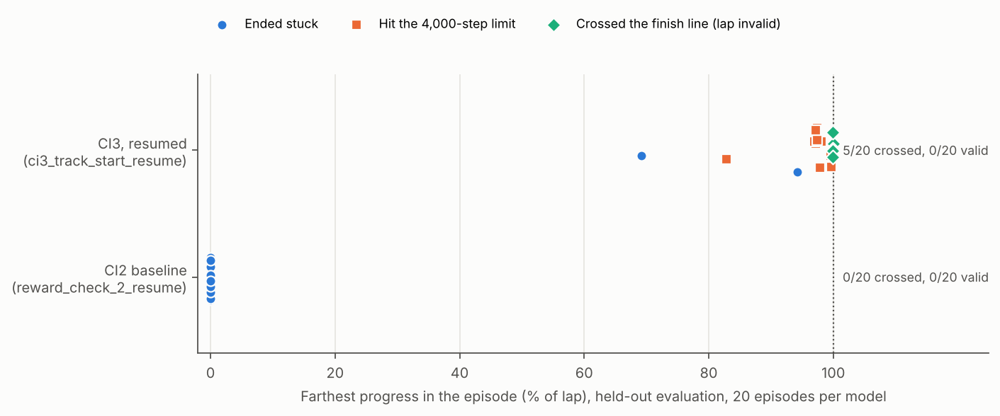
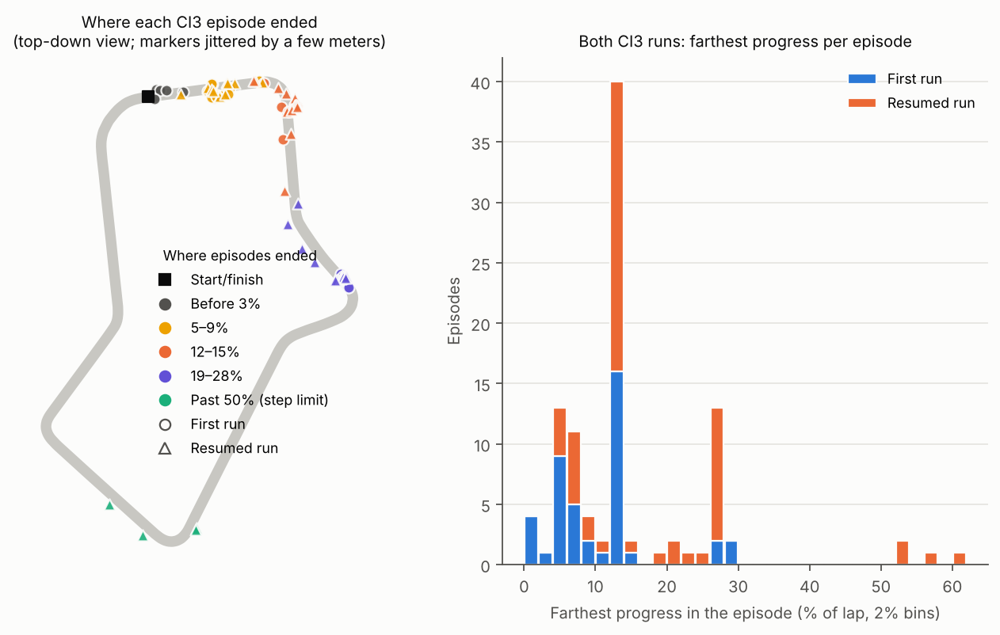

# DSAN-6600-Project

Semester Project for DSAN 6600: Deep Learning and Neural Networks

We use [ACRL](https://github.com/Jurredr/ACRL), a Soft Actor-Critic (SAC) implementation for Assetto Corsa, to train an agent that can drive a lap of a race track on its own. If it gets there, our next target is the lap time set by Assetto Corsa's built-in AI on the same car and track.

**Status (Check-In 3):** We added a data-centric extension to SAC (structured exploration and observation normalization) together with a set of bug fixes, and trained it for 140,541 steps (one seed, a first run and a resumed continuation). In held-out evaluation with the deterministic policy, the Check-In 2 model still does not move, while the CI3 model drives at about 73 km/h on average and gets past 97% of the lap in 16 of 20 episodes; it crossed the finish line in 5 of 20 episodes. None of those laps counts for Stage 1 yet, because the game marked every one invalid (the car left the track somewhere on the lap). In an ablation run with normalization only, the random phase barely moved the car, while structured exploration drove it at about 32 km/h; the comparison uses training logs from two machines with different step times, so it is not fully controlled.

## Check-In 3 at a Glance

| Rubric item | Where to look | Status |
| --- | --- | --- |
| Advanced extension | [3. Advanced Extension](#3-advanced-extension) | Implemented and trained ([3.4](#34-evidence-that-it-runs)) |
| Comparison with the CI2 baseline | [4. Comparison with the Baseline](#4-comparison-with-the-baseline) | Done: CI2 baseline vs. the resumed CI3 model, 20 held-out episodes each |
| Ablation / controlled comparison | [5. Ablation](#5-ablation) | Done on training logs: full extension vs. normalization only, same budget (not run through the held-out evaluation) |
| Failure analysis | [6. Failure Analysis](#6-failure-analysis) | Patterns from training and from the held-out evaluation |

**Key result:** In 20 held-out episodes each, the CI2 baseline advanced at most 0.03% of a lap from its starting position (every episode ended stuck after 100 steps), while the resumed CI3 model reached a median of 97.6%, crossed the finish line 5 times, and ran out of steps in 13 more, 12 of them between 97% and 99.7% of the lap. Valid laps: 0 of 20 for both, since all 20 CI3 laps were marked invalid. The gap mixes the extension with the shared fixes (Section 4.2). The ablation in Section 5 looks at the exploration part, with the limits stated there.

The full Check-In 2 write-up (training runs, log checks, and failure analysis of the original baseline) is in [check-in-2.md](check-in-2.md).

## 1. Project Overview

### 1.1 Goal

AI opponents largely decide how challenging and fun a racing simulator feels. Unlike chess or Go, racing needs continuous control of steering, throttle, and brake while reacting to how the car moves, and one small mistake can ruin a corner or invalidate a lap. We want to see how far an agent that learns only by driving can get.

| Stage | Goal | How we measure it |
| --- | --- | --- |
| **1. Complete a lap (main goal)** | From the standard start position, the agent drives forward to the finish line on its own, and the game never marks the lap invalid. | Lap completion rate in held-out evaluation; environment steps until the first completed lap |
| **2. Catch the built-in AI (stretch goal)** | Once the agent completes laps reliably, close the gap to Assetto Corsa's built-in AI in the same car on the same track. | Median time of full timed laps compared with the built-in AI's lap, re-recorded on our tires (the current reference, **1:25.454**, was set on faster tires) |

**What a completed lap means for Stage 1.** Every episode starts with the car at rest about 0.15% of a lap past the start/finish line. A Stage 1 lap is the drive from there, forward around the track, to the finish line: about 99.85% of the lap, from a standing start. It is not a full timed lap (line to line at racing speed), which only matters for Stage 2. The evaluation in [4.1](#41-evaluation-protocol) applies exactly this definition.

At Check-In 2, the SAC baseline never completed a lap: the original reward led the car toward standing still, and with a revised reward every episode still ended with the car stuck within the first 2.5% of the lap. For Check-In 3 we fixed the bugs found at Check-In 2 for every condition alike ([2.3](#23-shared-fixes-since-check-in-2)) and added one extension on top of SAC ([3](#3-advanced-extension)).

### 1.2 Scope

One car, one track, no opponents, fixed driving conditions.

| Setting | Value |
| --- | --- |
| Car and track | Ferrari 458 GT2 on Silverstone 1967 (the defaults in `main.py`) |
| Session settings | (To be added: tires, assists, weather, grip, fuel) |
| Hardware | (To be added) |
| Training budget | Check-In 2: about 720,000 environment steps over four runs. Check-In 3 so far: 39,418 steps (first run, ~1.1 hours) and 101,123 steps (resumed run, ~2.5 hours), both SAC + extension |

### 1.3 Repository and How to Run

| Folder or file | Contents |
| --- | --- |
| `README.md` | This write-up (Check-In 3) |
| `check-in-2.md` | Check-In 2 write-up, kept for reference |
| `figures/` | All plots in both write-ups |
| `logs/<run name>/` | Episode logs (`progress.txt`) and evaluation results of every run |
| (To be added) | Demo notebook with the comparison results |
| (To be added) | Code (layout below) |

```
ACRL.py                         # In-game app: sends telemetry from Assetto Corsa over a socket
standalone/
├── main.py                     # Entry point: settings, hyperparameters, start or resume training
├── evaluate.py                 # Held-out evaluation without learning
├── ac_controller.py            # Virtual Xbox controller (vgamepad)
├── ac_socket.py                # Socket connection to the in-game app
└── sac/
    ├── ac_environment.py       # Gymnasium environment: observations, reward, termination
    ├── sac.py                  # SAC agent, replay buffer, training loop
    ├── core.py                 # Actor and critic networks
    └── utils/                  # Reference-path geometry, logging
track_data/spline_points.csv    # Reference path (from upstream ACRL)
```

**Setup.** Install Assetto Corsa and follow the upstream [setup instructions](https://github.com/Jurredr/ACRL#readme), copy the in-game app into `assettocorsa/apps/python/ACRL`, enable it, and start a practice session with the car and track above.

**Commands** (from `standalone/`, with the game running):

| Task | Command |
| --- | --- |
| Train the extension (`ci3_track_start`) | In `main.py`: `EXTENSION_MODE = "full"`, then `python main.py` |
| Train the ablation condition | In `main.py`: `EXTENSION_MODE = "norm_only"`, `MAX_TOTAL_STEPS = 39418`, then `python main.py` (Section 5) |
| Evaluate a saved model | `python evaluate.py --model experiments/<run name> --episodes 20` |
| Evaluate random actions | `python evaluate.py --random --episodes 20 --seed 0` |

## 2. Baseline

### 2.1 Conditions Compared

| Name in this write-up | Run (model) | What it is | Used in |
| --- | --- | --- | --- |
| **CI2 baseline** | `reward_check_2_resume` | The SAC model saved at Check-In 2, trained with the Check-In 2 code and the revised reward (CI2 Section 3.1) | Section 4: the baseline the rubric asks us to compare against |
| **CI3, first run** | `ci3_track_start` | SAC + extension + shared fixes, trained from scratch for 39,418 steps in one go (seed 0) | Section 5 |
| **CI3, resumed** | `ci3_track_start_resume` | The first run continued to 140,541 steps in total | Section 4 |
| **CI3, normalization only** | `ci3_norm_only` | Same as the first run, but with uniform random actions drawn every step: only the observation normalization of the extension | Section 5 |

Section 4 compares the CI2 baseline with the resumed CI3 model. That difference mixes the extension with the shared fixes and the other changes since Check-In 2 (Section 4.2), so it shows how far the project moved, not what the extension alone did. Section 5 looks at one part of the extension: the first CI3 run and the normalization-only run differ in how random actions are drawn, and also in the machine they ran on.

### 2.2 Shared Setup

The settings below are the same for every CI3 run unless Section 3 says otherwise. The CI2 baseline was trained with the Check-In 2 settings; Section 4.2 lists the differences. Check-In 2 has the full description ([check-in-2.md, Section 2](check-in-2.md#2-neural-baseline-sac)).

| Component | Setting |
| --- | --- |
| Observation (10 values) | Lap progress, speed, world x/y/z, lap-invalid flag, lap count, previous lap progress, heading error and distance relative to the reference path |
| Action (2 values in [−1, 1]) | Combined throttle/brake, steering |
| Reward | The Check-In 2 progress + speed reward (`reward_id=4`), unchanged; the penalty for ending stuck is now −100 (was −40), and the same penalty applies when the car reverses over the start line |
| Episode end | Training completion threshold reached (99% progress; not the same as crossing the finish line, see [4.1](#41-evaluation-protocol)), car stuck (100 steps below 2 km/h), car reversed over the start line (`wrong_way`), or 4,000 steps |
| Policy | MLP 10 → 256 → 256, squashed Gaussian |
| Critics | Two MLPs 12 → 256 → 256 → 1, Polyak-averaged targets (0.999) |
| SAC settings | Adam, learning rate 1e-3, γ = 0.99, α = 0.2 (fixed), batch 32, buffer 10⁶, seed 0. A new run takes 10,001 random actions before the policy acts; a resumed run takes 1. Gradient updates start after 1,000 steps and run after each episode, one per environment step. |
| Control interval | At least 50 ms between observations. The median of the per-episode mean step time was 80 ms in the first CI3 run and 60 ms in the resumed run, so the 50 ms target was not reached ([6.4](#64-implications)). |

### 2.3 Shared Fixes Since Check-In 2

These fixes change the environment or the training loop, so they apply to every trained condition. Any improvement they cause is credited to the fixes, not to the extension.

| Fix | Problem it addresses (Check-In 2) | Status |
| --- | --- | --- |
| Model loading | Saved models could not be loaded ([CI2 4.2](check-in-2.md#42-saved-models-could-not-be-loaded)) | Done at Check-In 2 |
| Lap check | Reversing over the start line counted as a finished lap ([CI2 4.6](check-in-2.md#46-reversing-over-the-start-line-counts-as-a-finished-lap)) | Done: ends as `wrong_way` with the stuck penalty |
| Update timing | The car drove blind during gradient updates ([CI2 4.7](check-in-2.md#47-the-car-drives-blind-during-gradient-updates)) | Done: updates run after each episode with the car braked |
| Reset | One episode started 100 m down the track ([CI2 3.3](check-in-2.md#33-log-artifacts)) | Done: F10 is pressed again if the car did not respawn |
| Logging | End reasons, reward components, and step timestamps were not logged | Partly done: end reason, net and farthest progress, step time, update count and time, losses, and Q-values are logged; reward components are not |
| Stuck penalty | Getting stuck cost too little compared with driving ([CI2 4.5](check-in-2.md#45-the-revised-reward-may-still-give-too-little-incentive-to-drive)) | Done: −40 → −100. The reward function itself is unchanged; exploration is part of the extension (Section 3). |
| Control interval | Step time was not fixed (17–92 ms at Check-In 2) | Done: at least 50 ms per step |
| Step-limit bootstrapping | Hitting the step limit was stored as a terminal state | Done: only real endings stop bootstrapping |
| Q-network freeze | A one-shot iterator meant the critics were never frozen during the policy update | Done (bug fix) |
| In-game app | Socket encoding error broke the F10 respawn; app window could end up off-screen | Done: `ACRL.py` fixes and auto-start |

## 3. Advanced Extension

### 3.1 What We Added and Why

| | |
| --- | --- |
| Extension | Data-centric changes to what SAC learns from: structured exploration in the random phase, and fixed normalization of the observations fed to the policy and critics |
| Rubric category | Data-centric improvement tied to model behavior |
| What it adds beyond Check-In 2 | At Check-In 2, the replay buffer was filled with uniform random actions that braked half the time, and the networks received raw inputs on very different scales. The extension changes the data the networks train on and the form in which they see it. The SAC algorithm and the network sizes stay the same. |
| Scope | In: the random-phase action distribution and input normalization. Out: the reward, the environment, the network architecture, and the bug fixes in [2.3](#23-shared-fixes-since-check-in-2), which apply to every condition. |

**Motivation.** Two Check-In 2 findings point at the training data rather than at SAC itself:

- **The random phase produced almost no driving.** Throttle and brake share one action axis, so uniform random actions braked half the time, and a new action was drawn every step, so no throttle press lasted long enough to build speed. In the random phase of the revised-reward run, median speed was 2.1 km/h ([CI2 4.5](check-in-2.md#45-the-revised-reward-may-still-give-too-little-incentive-to-drive)). The first 10,001 transitions in the replay buffer therefore contain almost no examples of the car moving at real speed, which leaves the critics little to learn from about driving.
- **The inputs differ in scale by three orders of magnitude.** Lap progress lies in [0, 1], speed reaches 180 km/h, and the world coordinates reach about ±1,000 m on this track. Fed in raw, the coordinates dominate the first layer of every network.

**Hypothesis.** Under the same budget and shared fixes, the extension raises the speed reached in the random phase and, after the policy takes over, increases net progress and farthest progress per episode and lowers the share of episodes that end stuck. Section 5 tests the exploration part of this directly.

**How the Check-In 3 code changes are split.** The changes made since Check-In 2 that belong to the extension are switched on and off together in `main.py`; everything else applies to every condition.

| Change | Where | Extension or shared fix |
| --- | --- | --- |
| Throttle-biased, held random actions | `sac.py`, `main.py` | Extension |
| Observation normalization | `core.py`, `sac.py`, `ac_environment.py` | Extension |
| Updates run between episodes, car braked | `sac.py` | Shared fix ([CI2 4.7](check-in-2.md#47-the-car-drives-blind-during-gradient-updates)) |
| Fixed 50 ms control interval | `ac_environment.py` | Shared fix |
| Reversing over the start line ends the episode as `wrong_way` | `ac_environment.py` | Shared fix ([CI2 4.6](check-in-2.md#46-reversing-over-the-start-line-counts-as-a-finished-lap)) |
| Reset check (re-press F10 if the car did not respawn) | `ac_environment.py` | Shared fix ([CI2 3.3](check-in-2.md#33-log-artifacts)) |
| Stuck penalty −40 → −100 | `main.py` | Shared fix ([CI2 4.5](check-in-2.md#45-the-revised-reward-may-still-give-too-little-incentive-to-drive)) |
| No `done` flag at the step limit (critic keeps bootstrapping) | `sac.py` | Shared fix |
| Q-networks actually frozen during the policy update | `sac.py` | Shared fix (bug) |
| New log columns: end reason, net and farthest progress, step time, update count and time, losses, Q-values | `sac.py` | Shared fix |
| In-game app: socket and F10 respawn fixes, auto-start, camera lock only outside the pit | `ACRL.py` | Shared fix |

### 3.2 Design

Both parts sit at the edges of SAC: one changes which transitions enter the replay buffer, the other changes what the networks see. The policy, the critics, and the SAC updates are unchanged.

```
random phase (first 10,001 actions):  biased, held random action ─┐
policy phase:                          policy action (every step) ─┤
                                                                   ▼
                                              Assetto Corsa (50 ms per step)
                                                                   │
                                     transition (s, a, r, s') ─► replay buffer
                                                                   │
                     s ─► (s − center) / scale ─► policy MLP and both critic MLPs
```

**Structured exploration.** During the random phase, each random action is drawn as follows and then held for 5–15 steps (0.25–0.75 s at 50 ms per step):

| Action axis | Without the extension | SAC + extension |
| --- | --- | --- |
| Throttle/brake | Uniform in [−1, 1]: brakes half the time | Uniform in [−0.2, 1]: throttle on about 83% of draws, braking only light |
| Steering | Uniform in [−1, 1] (up to ±270°) | Uniform in [−0.5, 0.5]: holding full lock for several steps mostly spins the car |
| New action drawn | Every step | Every 5–15 steps |

Once the policy takes over, it chooses a new action every step in both conditions. A run resumed from a saved model skips the random phase (`start_steps` is set to 0), so this part applies only to its first action.

**Observation normalization.** Each input is mapped to roughly [−1, 1] as `(s − center) / scale` before the first layer of the policy and of both critics. The constants are fixed by hand from the known range of each input, not estimated from data:

| Input | Center | Scale | Note |
| --- | --- | --- | --- |
| Lap progress, previous lap progress | 0.5 | 0.5 | |
| Speed (km/h) | 90 | 90 | Half of `max_speed` |
| World x, y, z (m) | 0 | 1,000 | Silverstone 1967 lies within about ±1,000 m (the observation bound is ±2,000) |
| Lap-invalid flag | 0.5 | 0.5 | |
| Lap count | 1.5 | 0.5 | |
| Heading error (rad) | π/2 | π/2 | |
| Distance from the reference path (m) | 10 | 10 | Normal values are 0–20 m; the 0–500 bound would squash them toward −1 |

The constants are stored inside the model as buffers, so `model.pt` carries them and `evaluate.py` or a resumed run applies the same normalization automatically. Models saved before this change have no such buffers and still run without normalization.

| Component | Without the extension | SAC + extension |
| --- | --- | --- |
| Observation | 10 raw values | The same 10 values, normalized inside each network |
| Policy network | MLP 10 → 256 → 256, squashed Gaussian | Same |
| Critic networks | Two MLPs 12 → 256 → 256 → 1 | Same, on normalized observations |
| Random phase | Uniform actions, new one every step | Biased actions, each held for 5–15 steps |
| Trainable parameters | ~208,000 | ~208,000 (the normalization constants are fixed buffers, not trained) |

### 3.3 Implementation

| Item | Details |
| --- | --- |
| Files changed | `standalone/sac/core.py`: optional `(center, scale)` buffers in the actor and both critics, applied in `forward`. `standalone/sac/sac.py`: `_sample_explore_action` (biased, held random actions) and the new options of `SacAgent`. `standalone/sac/ac_environment.py`: `obs_norm_center` and `obs_norm_scale`. `standalone/main.py`: the settings below. Changed lines are marked `[CI3 change]`, with the old code kept as comments. |
| How to turn it on | In `HYPERPARAMS` in `main.py`: `explore_throttle_range=(-0.2, 1.0)`, `explore_steer_range=(-0.5, 0.5)`, `explore_action_repeat=(5, 15)`, `normalize_obs=True` (the current settings) |
| How to turn it off (baseline) | `explore_throttle_range=(-1.0, 1.0)`, `explore_steer_range=(-1.0, 1.0)`, `explore_action_repeat=(1, 1)`, `normalize_obs=False`, which reproduce the old uniform sampling and raw inputs. The shared fixes stay on. |
| Extra hyperparameters | The two exploration ranges, the hold length (5–15 steps), and the normalization constants above. `policy_action_repeat` stays at 1. |
| Extra compute | No extra trainable parameters; normalization adds one subtraction and one division per input. (To be added: measured time per step and per update, from the new `StepTime` and `UpdateTime` log columns) |

### 3.4 Evidence That It Runs

We trained SAC + extension with the shared fixes from scratch (`ci3_track_start`, seed 0), then resumed it from its saved model in a second run (`ci3_track_start_resume`; its `config.json` records `load_path=experiments/ci3_track_start` and `start_steps=0`). Both are training episodes with a stochastic policy, not the held-out evaluation in Section 4.

| Run | Episodes | Environment steps | Wall-clock time | Median of per-episode mean step time | Logs |
| --- | --- | --- | --- | --- | --- |
| First run (`ci3_track_start`) | 45 | 39,418 | ~1.1 h | 80 ms | [progress.txt](logs/ci3_track_start/progress.txt) |
| Resumed run (`ci3_track_start_resume`) | 58 | 101,123 | ~2.5 h | 60 ms | [progress.txt](logs/ci3_track_start_resume/progress.txt) |

| Episodes | Actions | Median length (steps) | Median speed (km/h) | Median farthest progress (% of lap) | Farthest (% of lap) | End reasons |
| --- | --- | --- | --- | --- | --- | --- |
| First run, 1–16 | Random | 530 | 31.6 | 5.8 | 13.1 | 14 stuck, 2 wrong way |
| First run, 17 | Random (60 steps), then policy | 956 | 67.0 | 28.4 | 28.4 | Stuck |
| First run, 18–45 | Policy | 653 | 34.0 | 12.4 | 28.5 | 26 stuck, 2 step limit |
| Resumed, 1–20 | Policy | 1,354 | 37.1 | 12.6 | 27.6 | 20 stuck |
| Resumed, 21–40 | Policy | 1,594 | 31.7 | 12.6 | 27.8 | 20 stuck |
| Resumed, 41–58 | Policy | 1,740 | 39.8 | 12.6 | 61.1 | 13 stuck, 5 step limit |
| Check-In 2, revised reward (189 episodes, for reference) | Random, then policy | 346–593 | 2.1–3.2 | — | 2.4 | All stuck |

These rows include every episode, wrong-way episodes too. Only the location analysis in [6.1](#61-failure-patterns-of-the-extension) leaves wrong-way episodes out.


*Farthest progress, average speed, and episode length for every episode of the first CI3 run (1–45) and the resumed run (46–103), with a 10-episode rolling median for speed and length. The shaded band marks the random phase. Marker shape shows how each episode ended.*

**What the two runs show**

- **The extension runs end to end.** The random phase used throttle-biased, held actions (`RandomFrac` = 1 through episode 16, and 60 steps of episode 17, 10,001 actions in total). The loaded model kept its observation normalization in the resumed run.
- **The random phase now drives.** Its median speed was 31.6 km/h and it got as far as 13.1% of the lap, compared with 2.1 km/h and 2.2% in the Check-In 2 random phase. The replay buffer therefore starts with real driving.
- **The car went much further than at Check-In 2,** but not around the lap. The first run's best was 28.5%, the resumed run's 61.1% (about 2.9 km). Those long drives were probably not clean: the logs suggest that six of the seven step-limit episodes had received the one-time off-track penalty, meaning the game had marked the lap invalid ([6.1](#61-failure-patterns-of-the-extension)). Five resumed episodes and one first-run episode ended with a positive total reward; none did at Check-In 2.
- **Progress stalls at fixed places during training.** The held-out evaluation in [4.3](#43-results) shows the deterministic policy getting much further. The median farthest progress sat at 12.4–12.6% for the whole of both policy phases, because most episodes end at the same corner ([6.1](#61-failure-patterns-of-the-extension)).
- **The step limit now binds.** None of the five step-limit endings in the resumed run was a stuck car, and four of them came past 53% of the lap.

These runs changed the extension and the shared fixes at the same time, and the car now spawns just before the start line and is driven across it before each episode starts. They show that the system works and how it fails; they do not show that the extension caused the improvement. Section 5 tests the exploration part with a controlled run.

## 4. Comparison with the Baseline

**Status:** the CI2 baseline and the resumed CI3 model were evaluated with `evaluate.py`, 20 episodes each, on one machine with about 60 ms per step. We did not have time to also evaluate random actions, the first CI3 run, or the normalization-only run.

```
python evaluate.py --model experiments/reward_check_2_resume --episodes 20
python evaluate.py --model experiments/ci3_track_start_resume --episodes 20
```

Results: [eval_reward_check_2_resume.csv](logs/eval/eval_reward_check_2_resume.csv), [eval_ci3_track_start_resume.csv](logs/eval/eval_ci3_track_start_resume.csv).

### 4.1 Evaluation Protocol

Training episodes use a stochastic policy that is still learning, so all conditions are compared on separate held-out episodes instead.

| Item | Setting |
| --- | --- |
| Tool | `standalone/evaluate.py`: loads a saved model and drives with it; no gradient updates and no replay buffer, so nothing it sees reaches training |
| Conditions | The CI2 baseline and the resumed CI3 model ([2.1](#21-conditions-compared)) |
| Actions | Deterministic mean action of the policy |
| Episodes | 20 per model |
| Seeds | One training seed (0) per model |
| Checkpoint | The last `model.pt` of each run, fixed before evaluation |
| Machine | One machine for both models (about 60 ms per step) |
| Start | Standard reset and scripted launch, as in training |
| Environment | The current settings in `main.py` for every model, including the CI2 baseline: shared setup in [2.2](#22-shared-setup) and fixes in [2.3](#23-shared-fixes-since-check-in-2). The CI2 model has no normalization constants, so it receives raw inputs as it did in training. The script also applies the stuck rule after 99% progress, where the environment would otherwise report the lap as done. |

**Completed lap.** A Stage 1 lap as defined in [1.1](#11-goal): the game's lap count goes up because the car crossed the finish line going forward, the game never marked the lap invalid, and lap progress never jumped by more than half a lap in one step (a backward crossing of the start line ends the episode as a failure). Episodes where the environment reports 99% progress but the car never crosses the line do not count.

**Metrics.**

| Metric | Use |
| --- | --- |
| Lap completion rate | Main metric (Stage 1) |
| Net progress per episode, farthest progress | Progress before any lap is completed |
| Share of episodes ending stuck, and where they end | Failure analysis |
| Average speed | Secondary |
| Approximate lap time (completed laps only) | Reported, not compared: it is the game's timer at the last sample before the line, from a standing start |
| Training wall-clock time | Cost |

### 4.2 What Differs Between the CI2 Baseline and the CI3 Models

The evaluation is the same for every model; their training was not.

| Item | CI2 baseline | CI3 runs |
| --- | --- | --- |
| Reward | `reward_id=4`, stuck penalty −40 | `reward_id=4`, stuck penalty −100 |
| Episode end | Stuck, 99% progress, or 4,000 steps; reversing over the line counted as a lap | Adds `wrong_way` |
| Updates | Every 50 steps while the car kept driving | Between episodes, car braked |
| Control interval | Not fixed (17–92 ms) | At least 50 ms (measured 60–80 ms) |
| Random phase | Uniform, new action every step | Structured exploration (extension) |
| Inputs | Raw | Normalized (extension) |
| Start | About 0.15% past the line | Just before the line, then driven across |
| Training budget | 119,138 + 29,900 steps (resumed once) | 39,418 (first run); 39,418 + 101,123 (resumed once) |
| Seed | 0 | 0 |

So a difference in Section 4.3 measures the combined effect of all these changes.

**Training schedule.** Resuming is not the same as training without a break: the current code starts a resumed run with an empty replay buffer, a new optimizer, a reset step counter, and a single random action. Both the CI2 baseline and the resumed CI3 run were resumed once, at different points. The controlled comparison in Section 5 avoids this by training both conditions from scratch in one go with the same budget.

### 4.3 Results

| Metric | CI2 baseline | CI3, resumed |
| --- | --- | --- |
| Valid laps (Stage 1) | 0 / 20 | 0 / 20 |
| Finish line crossed (any lap) | 0 / 20 | 5 / 20, all marked invalid |
| Median net progress per episode (% of lap) | 0.03 | 97.6 (IQR 97.2–99.7) |
| Farthest progress (% of lap) | 0.03 | 99.97 |
| End reasons | 20 stuck | 13 step limit, 5 crossed the line, 2 stuck |
| Laps marked invalid by the game | 0 / 20 | 20 / 20 |
| Median average speed (km/h) | 0.8 | 73.4 |
| Training steps / wall-clock time | 149,038 / ~2.3 h | 140,541 / ~3.6 h |



*Farthest progress in each of the 20 evaluation episodes per model, with the deterministic policy. Marker shape shows how each episode ended. All five finish-line crossings of the CI3 model were on laps the game had marked invalid.*

**What the numbers show.**

- **CI2 baseline.** The car creeps at about 0.8 km/h and every episode ends stuck after exactly 100 steps, having advanced at most 0.03% of a lap from its starting position. This is the standstill behavior seen at Check-In 2 ([CI2 4.1](check-in-2.md#41-the-policy-learned-to-stand-still)), now confirmed outside training.
- **CI3, resumed.** The car drives the whole lap at racing speed (median 73 km/h, top speeds of 125–153 km/h). It got past 97% of the lap in 16 of 20 episodes. It crossed the line in 5; 13 ran out of steps, 12 of them 15–145 m short of the line and one at 83%; 2 ended stuck at 69% and 94%. The episodes that crossed took 3,946–3,998 steps, about 4 minutes at ~60 ms per step. This is not comparable with the built-in AI's 1:25: our laps start from a standstill before the line, use different tires, and were invalid.
- **Why no valid lap.** All 20 CI3 laps were marked invalid by the game at some point. `evaluate.py` records whether this happened, not where, so we cannot yet say which part of the track causes it. The training analysis (Section 6.1) showed the long drives running 20–40 m from the reference line, which suggests the car leaves the track on at least one section.
- **The final deterministic policy went much further than the training episodes.** Episodes of the resumed training run had a median farthest progress of 12.6%; the final checkpoint, evaluated with the mean action, got past 97% in most episodes. The two numbers are not a like-for-like comparison: the training figure comes from many episodes while the weights were still changing, and those episodes sample actions with a fixed entropy weight (α = 0.2). Both a more mature final policy and the absence of sampling noise may contribute. Separating them would need the same final checkpoint evaluated with sampled and with mean actions.

### 4.4 What Improved, What Got Worse, and Why

- **Improved:** Median progress per episode went from 0.03% to 97.6% of the lap, median average speed from 0.8 to 73 km/h, and the car crossed the finish line for the first time (5 of 20 episodes).
- **Worse or unchanged:** Valid laps stay at 0. The CI3 model drives off the track somewhere on every lap, and the 4,000-step limit now ends most episodes just before the line.
- **Why:** The CI3 model differs from the CI2 baseline in the extension, the shared fixes, the stuck penalty, the update timing, and the training schedule (Section 4.2), so this comparison cannot say which change mattered most. Section 5 tests one of them, structured exploration. The large gap between the CI2 and CI3 models is consistent with the CI2 diagnosis: once the replay buffer contains real driving and the update pauses no longer interrupt control, SAC learns to drive.
- **How sure we are:** One training seed per model and 20 evaluation episodes each. The difference (0.03% vs. 97.6% median progress, with no overlap between any two episodes) is far larger than the spread between episodes, so the difference between these two checkpoints is clear. Twenty evaluation episodes do not stand in for more training seeds, though, and what caused the difference is not settled.

## 5. Ablation

A controlled comparison of one part of the extension: does structured exploration help on top of observation normalization?

| | CI3, first run (`ci3_track_start`) | CI3, normalization only (`ci3_norm_only`) |
| --- | --- | --- |
| Random phase | Throttle-biased, held random actions | Uniform random actions, new one every step |
| Observation normalization | On | On |
| Everything else | Same code, reward, shared fixes, seed (0), and budget (39,418 steps, from scratch, in one go) | Same, but trained on a different machine (see below) |
| `main.py` | `EXTENSION_MODE = "full"` | `EXTENSION_MODE = "norm_only"`, `MAX_TOTAL_STEPS = 39418` |

`MAX_TOTAL_STEPS` ended the normalization-only run after episode 22, at 39,437 steps (log: [progress.txt](logs/ci3_norm_only/progress.txt)). Both runs used the same environment settings, but they ran on different machines: the mean step time was about 80 ms for `ci3_track_start` and 62 ms for `ci3_norm_only`. That changes more than the total driving time (about 53 vs. 41 minutes for the same number of steps): it also changes how long each held random action lasts in seconds, how much progress reward one step can earn, and how many seconds the 100-step stuck rule takes. This is therefore an exploration ablation with a step-time confound, not a fully controlled comparison. The mixed episodes, where the policy takes over partway, are left out of both the random-only and the policy-only rows.

**Expected result (stated before the run).** The normalization-only run behaves like the Check-In 2 random phase at the start (slow, little progress) and reaches less progress after the same budget.

| Metric (training log) | CI3, first run (full extension) | CI3, normalization only |
| --- | --- | --- |
| Episodes with random actions only | 1–16 | 1–2 |
| Mixed episode (random, then policy) | 17 (60 random steps) | 3 (2,001 random + 554 policy steps) |
| Random-only episodes: median speed / farthest progress | 31.6 km/h / 13.1% | 2.7 km/h / 3.7% |
| Random-only episodes: how they ended | 14 stuck, 2 wrong way | 2 step limit |
| Policy-only episodes | 18–45 (28) | 4–22 (19) |
| Policy-only episodes: median speed | 34.0 km/h | 23.7 km/h |
| Policy-only episodes: median farthest progress | 12.4% | 11.6% |
| Policy-only episodes reaching 12% of the lap | 16 of 28 | 6 of 19 |
| Farthest progress in the run | 28.5% | 23.4% |

**Interpretation (training logs).**

- **With structured exploration, the random phase drove; without it, it barely did.** With uniform random actions, the car crept at 2.7 km/h and got at most 3.7% of the way round. The speed hovered around the 2 km/h stuck threshold, so both random-only episodes ran the full 4,000 steps. With the extension, the random-only episodes averaged 31.6 km/h and reached 13% of the lap. The replay buffer of the normalization-only run therefore starts with very little driving, as at Check-In 2. The step-time difference is unlikely to explain a gap this large, but it is part of it.
- **After the policy took over, the gap was smaller.** The normalization-only run also learned to drive and reached the same 12.5% corner. Its median speed stayed lower (23.7 vs. 34.0 km/h), fewer of its episodes reached the corner, and its best episode got less far.
- **The gap is smaller than the random phase suggests,** and the step-time difference above favors the full extension by about 12 minutes of driving, so part of the policy-phase gap may come from that rather than from exploration.

**Limits.** This comparison uses training episodes only; we did not have time to run the two models through `evaluate.py`. Section 4.3 shows that training episodes can look very different from a held-out evaluation of the final checkpoint (12.6% vs. 97.6% median farthest progress for the resumed run), so the policy-only numbers above say how the two runs trained, not how well their final policies drive. The random-phase numbers do not have this problem, since no policy is involved there. One seed per condition, two machines with different step times, and the effect of normalization on its own (`EXTENSION_MODE = "off"`) is not tested. What this ablation supports is narrower than "exploration helps": with structured exploration we observed much faster early driving, and somewhat faster driving later in training.

## 6. Failure Analysis

### 6.1 Failure Patterns of the Extension

| Pattern | Episodes (share) | Where on the track | Example (run, seed, episode) | Likely cause |
| --- | --- | --- | --- | --- |
| Leaves the track at the first right-hander and stops | First run 17 of 43, resumed 26 of 58 | About 12.5% of the lap (~600 m), where the opening straight turns right | First run, episodes 9, 16, 24, 41–44; resumed, episodes 39–44 | The car stops about 33 m off the reference line within 5 m of the same point, (x, z) ≈ (438, −785), in 32 episodes across both runs. Hypothesis: it reaches the corner too fast and does not brake. Episodes that stopped here were going faster at 10% of the lap (median 68 km/h, 37 episodes) than episodes that got past the corner (57 km/h, 26 episodes), but the ranges overlap widely, so this only weakly supports the hypothesis. The observation has no explicit look-ahead, such as the curvature of the track ahead. The policy could still learn where this corner is from lap progress and world position, since there is only one track, but nothing tells it directly that a corner is coming. |
| Runs wide on the opening straight | First run 16 of 43, resumed 12 of 58 | About 5–9% of the lap | First run, episodes 1, 8, 11, 25; resumed, episodes 2, 26, 34 | Most of these stop about 30 m off the line: the car drifts off the straight before the first corner |
| Stops at the right-hand kink | First run 4 of 43, resumed 11 of 58 | About 27.5% of the lap (~1.3 km) | First run, episodes 17, 26, 45; resumed, episodes 33, 37, 45 | The second place where episodes repeatedly end, mostly 12–25 m off the reference line |
| Hits the step limit while still driving, probably on an invalid lap | First run 2 of 45, resumed 5 of 58 | 53–61% of the lap in four resumed episodes | Resumed episodes 49 and 53 | At the observed ~60 ms per step, 4,000 steps is about 4 minutes; at the 42–48 km/h these episodes averaged, a full lap would take about 6,000–6,800 steps. Six of the seven step-limit episodes have a lowest step reward of −4.8 to −4.9 and never lost more than 0.003% of a lap in one step, so no other reward term can explain that value: they most likely received the one-time −5 off-track penalty, which means the game had marked the lap invalid. The seventh (resumed episode 48, lowest step reward −5.4) also had a backward progress step of −1% of a lap, and clipped backward progress (−5) plus the low-speed penalty (−0.4) gives the same −5.4, so its lap status is uncertain. Logging the lap-invalid flag would settle this. The four longest drives spent 57–72% of their steps more than 15 m from the reference line. |
| Reverses over the start line | First run 2 of 45, resumed 0 | Start line | First run, episodes 5 and 10 (random phase) | Ended as `wrong_way` with the −100 penalty, as intended |

Counts use each episode's farthest progress (`EpFarthest`) and end reason from `progress.txt`; wrong-way episodes are excluded from the location rows. End positions, distances from the reference line, and speeds come from `drive_data.json` of both runs. The invalid-lap check relies on the logged lowest step reward and largest backward progress step, because the lap-invalid flag and the reward components are not logged. All counts are from training episodes.

### 6.2 Concrete Examples



*Left: where each episode of both CI3 runs ended (wrong-way episodes left out), on a top-down view of the track; the car drives clockwise from the start/finish line. Right: farthest progress per episode, in 2% bins. The peaks at about 5–9%, 12.5%, and 27.5% are the three places where episodes keep ending.*


| Episode | What happens |
| --- | --- |
| **Resumed, episode 41** (ends at the 12.5% corner) | Reaches about 95 km/h on the opening straight, still runs 70–85 km/h near 10%, then leaves the track at the first right-hander and stops about 33 m off the line. |
| **Resumed, episode 33** (ends at 27.8%) | Gets through the first corner at about 40 km/h, accelerates to about 70 km/h down the next section, then stops at the right-hand kink. |
| **Resumed, episode 53** (61% at the step limit) | The farthest drive so far. It also takes the first corner slowly, but from about 10% of the lap on it runs mostly 20–40 m from the reference line, wide of the track drawn on the map, and the lap is marked invalid. The step limit ends it while it is still moving at about 50 km/h. |

Watching the runs, we saw why so many episodes end at the 12.5% corner: a wall juts out diagonally at the exit of the first turn. The car hits it, bounces off just far enough to accelerate into it again, and repeats. The driving data shows the same pattern: after first coming within 15 m of that point, the car's speed rose above 5 km/h again 18 times in resumed episode 35 (1,662 steps), 21 times in resumed episode 48 (3,313 steps, ended by the step limit), and 9 times in first-run episode 23 (744 steps). Each burst moves the car just enough to reset the stuck counter, so these episodes run on long after progress stops. A stronger off-track penalty should keep the car away from this wall more often, but some parts of the track have little or no grass run-off before the wall, so wall contact may need its own handling later.

### 6.3 Check-In 2 Failures Now

| CI2 failure | Addressed by | Evidence | Remaining issue |
| --- | --- | --- | --- |
| Drift toward standing still ([CI2 4.1](check-in-2.md#41-the-policy-learned-to-stand-still)) | Not separable yet (shared fixes and extension changed together) | Median speed 32–37 km/h in both CI3 runs, with no downward trend, vs. 0.8 km/h at the end of the CI2 overnight run | None seen so far |
| Every episode ends stuck ([CI2 4.5](check-in-2.md#45-the-revised-reward-may-still-give-too-little-incentive-to-drive)) | Not separable yet | Still 94 of 103 episodes, but mostly after driving 5–28% of the lap rather than within the first 2.5% | Episodes end at the same corners ([6.1](#61-failure-patterns-of-the-extension)) |
| False lap from reversing over the start line ([CI2 4.6](check-in-2.md#46-reversing-over-the-start-line-counts-as-a-finished-lap)) | Shared fix (lap check) | Two random-phase episodes of the first run reversed over the line; both ended as `wrong_way` with the −100 penalty, and their net progress was logged as −1%, not 99% | None seen |
| Driving blind during gradient updates ([CI2 4.7](check-in-2.md#47-the-car-drives-blind-during-gradient-updates)) | Shared fix (update timing) | All updates now run between episodes (`NumUpdates` per episode); the per-episode mean step time stays within 77–83 ms (first run) and 57–63 ms (resumed run). Only the per-episode mean is logged, so single slow steps inside an episode cannot be ruled out. | Updates take 12–30% of wall-clock time while the car waits |
| Faulty reset ([CI2 3.3](check-in-2.md#33-log-artifacts)) | Shared fix (reset) | All 103 episodes in both runs started at the start line; no failed respawn was seen | None seen |

### 6.4 Implications

- **The 4,000-step limit now ends most evaluation episodes just short of the line.** At ~60 ms per step, 4,000 steps is 4 minutes, and the CI3 model needs about that long for a lap; 13 of 20 evaluation episodes ran out of steps, 12 of them at 97–99.7%. Raising the limit (or setting it in seconds) for every condition, and running a longer evaluation, would show how many of these could also cross the line. They would still not be valid laps, since every lap was already invalid.
- **The 50 ms control interval was not reached.** The per-episode mean step time was about 80 ms and 60 ms in the two runs, probably because reading the game state takes longer than 50 ms on the machines used. The interval is a floor, not a fixed value, so the two runs saw different amounts of driving per step. The comparison runs should use the same machine, and the interval should be set at or above the step time actually achieved.
- **The furthest progress comes off the track.** The reward charges a one-time −5 when the lap becomes invalid and then halves positive rewards, which is small next to what an episode earns by driving on. A valid Stage 1 lap needs the car to stay on track, so the evaluation counts these laps as failures. Logging the lap-invalid flag per episode, and a larger or repeated off-track penalty, would make this visible and costly. (To be added: decision, applied to every condition)
- **Training episodes can understate the final policy.** The training logs made the 12.5% corner look like a wall the agent could not pass, but the final checkpoint with the mean action gets through it in almost every evaluation episode. Whether sampling noise (fixed α = 0.2) or a still-improving policy explains most of this is not yet known; evaluating the final checkpoint with sampled actions would tell. Either way, the agent should be judged by held-out evaluation, and automatic tuning of α is worth considering as a way to adjust the amount of exploration.
- **The main remaining problem is staying on the track.** With the car now able to drive the whole lap, Stage 1 depends on the lap staying valid. That needs the off-track changes above, and an `evaluate.py` that records where the lap became invalid.

### 6.5 Remaining Limitations

- One car, one track, and fixed conditions, so the results say nothing about other cars, tracks, or conditions.
- Training runs in real time on one laptop, which limits the budget and the number of seeds.
- Both CI3 runs use one seed (0), and the second run continues the first. Any difference between conditions has to be larger than the variation between seeds before we can trust it. (To be added: seeds used in the comparison)
- (To be added: limitations of the extension)

## 7. Next Steps

1. Evaluate the first CI3 run and the normalization-only run with `evaluate.py`, so the ablation is judged on held-out episodes too (Section 5).
2. Make `evaluate.py` record where the lap becomes invalid, and log the invalid flag during training.
3. Evaluate the final CI3 checkpoint with sampled actions as well as mean actions, to see how much of the training/evaluation gap comes from sampling noise.
4. Raise the step limit (or set it in seconds) and fix the control interval to a value every machine reaches, for all conditions.
5. Add a progress-based stall rule so episodes stuck against a wall end early (Section 6.2).
6. Look at the 12.5% corner in detail: speed and steering on approach, and whether a look-ahead input would help.
7. Revise the reward for every condition: a larger off-track (grass) penalty, a cost for hitting walls, and a cost for reversing unless it is needed to recover.

## AI Disclosure

Claude (Anthropic) was used to edit the README and its structure, to help the analysis and plotting scripts and `evaluate.py`, and to suggest debugging ideas and code fixes. All results come from our own training runs, and the numbers and figures in this README were checked against the logs in `logs/`.
